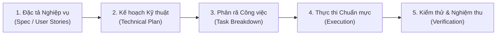

# 📋 SPEC-DRIVEN DEVELOPMENT (SPEC-KIT) SKILL
### DỰ ÁN HỆ THỐNG ĐIỀU HÀNH NỘI BỘ "FAMILY CN23" - VPĐK CHI NHÁNH 23

> **Vị trí lưu trữ:** `.agent/skills/spec-driven/SKILL.md`  
> **Mục đích:** Cung cấp bộ khung phương pháp luận **Spec-Driven Development (SDD)** chuẩn hóa (tương tự GitHub Spec-Kit), giúp Agent và Lập trình viên làm rõ yêu cầu, thiết kế kiến trúc và phân rã công việc một cách kỷ luật trước khi bắt tay viết code.

---

## 🧭 1. KHI NÀO CẦN ÁP DỤNG SPEC-DRIVEN?

Theo [`.agent/rules.md`](file:///C:/Users/X/Desktop/vpdk-cn23/.agent/rules.md), các tác vụ tinh chỉnh nhỏ (sửa lỗi hiển thị, chỉnh CSS, thêm nhãn) sẽ dùng **Agile Pair-Programming** nhanh gọn.

**BẮT BUỘC kích hoạt Spec-Driven Workflow khi gặp các trường hợp sau:**
1. **Phát triển tính năng / Phân hệ mới** (VD: Thêm phân hệ Quản lý Tài sản, Quản lý Hồ sơ trễ hạn).
2. **Thay đổi cấu trúc Dữ liệu hoặc API Contract** (Thay đổi schema Google Sheets, thêm action mới vào Google Apps Script).
3. **Tái cấu trúc (Refactoring) quy mô lớn** liên quan đến nhiều tệp (`layout.js`, `auth.js`, các module JS chính).
4. **Luồng nghiệp vụ phức tạp** có phân quyền chặt chẽ (Admin vs Cán bộ), xử lý bất đồng bộ nhiều bước hoặc liên quan đến an toàn dữ liệu/PII.

---

## 🔄 2. QUY TRÌNH 5 BƯỚC SPEC-KIT (5-PHASE WORKFLOW)



---

### GIAI ĐOẠN 1: ĐẶC TẢ NGHIỆP VỤ (SPECIFICATION)
*Không viết code ở giai đoạn này. Tập trung làm rõ bài toán từ góc nhìn người dùng cán bộ VPĐK.*

1. **User Story chuẩn hóa:**
   - **Là (As a):** [Vai trò: Cán bộ tiếp nhận / Lãnh đạo / Quản trị IT...]
   - **Tôi muốn (I want to):** [Hành động / Tính năng cần làm]
   - **Để (So that):** [Mục đích nghiệp vụ / Giá trị mang lại]
2. **Tiêu chí chấp nhận (Acceptance Criteria - Gherkin style):**
   - **Given (Cho trước):** Trạng thái ban đầu (đã đăng nhập, quyền hạn, dữ liệu mẫu).
   - **When (Khi):** Hành động kích hoạt (click nút, nhập form, filter bảng).
   - **Then (Thì):** Kết quả mong đợi trên giao diện và dữ liệu.
3. **Các trường hợp ngoại lệ (Edge Cases & Boundaries):**
   - Mất mạng / Timeout từ Google Apps Script.
   - Dữ liệu trống / Dữ liệu đặc biệt (chứa ký tự HTML, Unicode có dấu, tên quá dài).
   - Thiết bị màn hình nhỏ (Mobile responsive) hoặc in ấn A4.

---

### GIAI ĐOẠN 2: THIẾT KẾ KỸ THUẬT & HỢP ĐỒNG DỮ LIỆU (TECHNICAL PLAN)
*Đối chiếu với [`.agent/skill.md`](file:///C:/Users/X/Desktop/vpdk-cn23/.agent/skill.md) để đảm bảo tuân thủ triết lý Pure Vanilla Web.*

1. **Kiến trúc Giao diện & DOM:**
   - Cấu trúc cây thẻ HTML5 Semantic (`<header>`, `<main class="max-w-7xl">`, `<section>`, `<footer>`).
   - Danh sách `data-action="..."` và `id` cần thiết.
   - Tokens màu áp dụng theo quy tắc **60 - 30 - 10** (`variables.css`).
2. **Hợp đồng API & Cấu trúc Dữ liệu (Contracts):**
   - Tên bảng Google Sheets / Tab dữ liệu liên quan.
   - Tham số Request: `{ action: "...", ... }`.
   - Cấu trúc Response: `{ success: boolean, data: [...], message?: string }`.
   - Cơ chế Fallback (POST &rarr; GET JSONP nếu gặp CORS).
3. **Trạng thái & Quản lý Bộ nhớ (State Management):**
   - Lưu trữ tạm thời: `sessionStorage["family_user"]`.
   - Biến trạng thái module (State Object khép kín trong IIFE hoặc Module Scope).
   - Event Delegation tại container cha, Debounce 300ms cho input tìm kiếm.

---

### GIAI ĐOẠN 3: PHÂN RÃ CÔNG VIỆC THÀNH TASK CHECKLIST (TASK BREAKDOWN)
*Phân rã thành các đầu việc nhỏ, có thể kiểm chứng độc lập (Atomic & Testable).*

Mẫu Task Checklist chuẩn:
```markdown
- [ ] Task 1 (Database/API): Cập nhật Apps Script backend và chuẩn bị tab Google Sheets.
- [ ] Task 2 (UI Markup): Khai báo cấu trúc HTML semantic, gán data-action, nhúng route guard.
- [ ] Task 3 (Styling): Định nghĩa CSS sử dụng biến CSS variables, hỗ trợ responsive & print.
- [ ] Task 4 (Logic & Controller): Xây dựng module JS, gắn Event Delegation, escapeHtml chống XSS.
- [ ] Task 5 (Data Integration): Kết nối API fetch, xử lý loading spinner và thông báo Toast.
- [ ] Task 6 (Verification): Kiểm thử 100% kịch bản nghiệm thu tại chỗ.
```

---

### GIAI ĐOẠN 4: THỰC THI (IMPLEMENTATION)
*Thực thi từng task theo thứ tự. Kiểm tra kỹ các quy định cấm kỵ:*

- ❌ **CẤM:** Dùng inline styles (`style="..."`) hoặc inline events (`onclick="..."`).
- ❌ **CẤM:** Nạp `@import` trong file CSS.
- ❌ **CẤM:** Gán trực tiếp chuỗi vào `innerHTML` mà không qua `escapeHtml()`.
- ❌ **CẤM:** Tự ý chạy `git push` lên remote repository mà không có lệnh của người dùng.
- ✅ **BẮT BUỘC:** Mọi nút bấm đều có `type="button"` hoặc `type="submit"`.
- ✅ **BẮT BUỘC:** Script nạp qua thuộc tính `defer`.
- ✅ **BẮT BUỘC:** Đặt Route Guard tức thì trong `<head>`: `<script src="js/auth.js"></script><script>FamilyAuth.requireAuth();</script>`.

---

### GIAI ĐOẠN 5: KIỂM THỬ NGHIỆM THU & BÀN GIAO (ACCEPTANCE VERIFICATION)

Trước khi xác nhận hoàn thành, tiến hành rà soát theo ma trận nghiệm thu:

| STT | Hạng mục kiểm tra | Tiêu chuẩn đạt | Kết quả |
| :-- | :---------------- | :------------- | :-----: |
| 1 | **Tốc độ nạp (Load Time)** | < 200ms trên máy cấu hình phổ thông, không build step | [ ] |
| 2 | **Giao diện (Design System)** | Tỷ lệ 60-30-10, đúng biến màu trong `variables.css` | [ ] |
| 3 | **Bảo mật (Security & XSS)** | 100% dữ liệu chuỗi được bọc qua hàm `escapeHtml()` | [ ] |
| 4 | **Phân quyền (Auth & Route)** | Chưa đăng nhập tự động đá về `index.html` | [ ] |
| 5 | **Responsive & In ấn** | Hiển thị tốt trên Desktop, Tablet, in ấn A4 chuẩn NĐ 30 | [ ] |
| 6 | **Console Log** | Không có lỗi đỏ (0 Error), không rò rỉ token/mật khẩu | [ ] |

---

## 📝 3. MẪU TÀI LIỆU ĐẶC TẢ TÍNH NĂNG (FEATURE SPEC TEMPLATE)

Khi người dùng yêu cầu soạn một đặc tả mới hoặc tạo artifact kế hoạch, áp dụng cấu trúc mẫu sau:

```markdown
# [SPEC] TÊN TÍNH NĂNG / PHÂN HỆ
**Mã đặc tả:** SPEC-CN23-[TÊN]  
**Người phụ trách:** AI Agent & Cán bộ phụ trách  
**Ngày khởi tạo:** YYYY-MM-DD  
**Trạng thái:** DRAFT / REVIEW / APPROVED / IN PROGRESS / DONE  

---

### 1. BỐI CẢNH & MỤC TIÊU NGHIỆP VỤ
- **Vấn đề hiện tại:** [Mô tả khó khăn cán bộ đang gặp phải]
- **Giải pháp:** [Tóm tắt giải pháp số hóa trên Family CN23]
- **Chỉ số đo lường thành công:** [VD: Giảm 50% thời gian tổng hợp, 0 giấy tờ in thừa]

---

### 2. YÊU CẦU CHỨC NĂNG (USER STORIES & CRITERIA)
- **US-01: [Tên hành động]**
  - *Mô tả:* Là [Vai trò], tôi muốn [Hành động] để [Mục đích].
  - *Acceptance Criteria:*
    - AC-01.1: Given ..., When ..., Then ...
    - AC-01.2: Given ..., When ..., Then ...
  - *Edge Cases:* [Xử lý khi lỗi mạng, dữ liệu trùng...]

---

### 3. KIẾN TRÚC KỸ THUẬT & DỮ LIỆU
- **Tệp tin tác động:**
  - HTML: `[ten_trang].html`
  - CSS: `css/[ten_trang].css`
  - JS: `js/[ten_trang].js`
- **Data Schema (Google Sheets):**
  - Cột A: `id` (string, UUID hoặc Timestamp)
  - Cột B: `ngay_tao` (DD/MM/YYYY)
  - ...
- **API Payloads:**
  - Endpoint: Google Apps Script Web App
  - Action: `[ten_action]`

---

### 4. KẾ HOẠCH TRIỂN KHAI (TASKS CHECKLIST)
- [ ] Task 1: ...
- [ ] Task 2: ...
- [ ] Task 3: ...

---

### 5. BIÊN BẢN NGHIỆM THU
- [ ] Kiểm thử chức năng theo AC
- [ ] Rà soát bảo mật & XSS
- [ ] Xác nhận của Người dùng
```

---

## 🔗 LIÊN KẾT TÀI LIỆU LIÊN QUAN
- [Cẩm nang kỹ thuật Front-end (`.agent/skill.md`)](file:///C:/Users/X/Desktop/vpdk-cn23/.agent/skill.md)
- [Quy chuẩn vận hành Master Rules (`.agent/rules.md`)](file:///C:/Users/X/Desktop/vpdk-cn23/.agent/rules.md)
- [Hồ sơ kịch bản kiểm thử mẫu (`docs/SPEC_WORKFLOW_TESTING.md`)](file:///C:/Users/X/Desktop/vpdk-cn23/docs/SPEC_WORKFLOW_TESTING.md)
