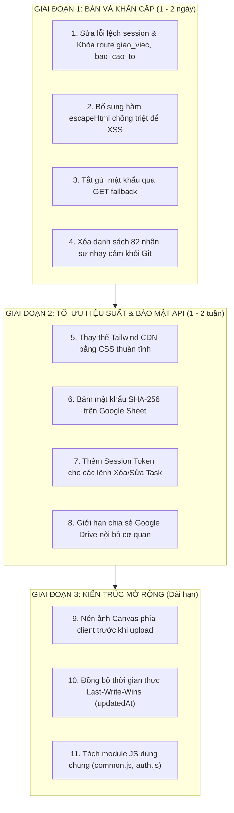

# BÁO CÁO TOÀN DIỆN VỀ BẢO MẬT & HIỆU SUẤT DỰ ÁN "FAMILY CN23" (THƯ MỤC A_THANG)
> **Cơ quan:** Văn phòng Đăng ký Đất đai TP.HCM - Chi nhánh số 23  
> **Phạm vi kiểm tra:** Toàn bộ thư mục [`A_THANG/`](file:///Users/admin/Desktop/FAMILY_CN23) (Mã nguồn Web Portal, Backend Google Apps Script, Bộ cài đặt Desktop, Tài nguyên & Tài liệu quy chuẩn)  
> **Thời điểm đánh giá:** Ngày 29 tháng 10 năm 2026  
> **Mục tiêu:** Nhận diện toàn diện các điểm yếu bảo mật và nút thắt hiệu suất, xếp loại mức độ ưu tiên từ Khẩn cấp đến Thấp để định hướng sửa chữa dần từng bước an toàn.

---

## 📑 MỤC LỤC
1. [TỔNG QUAN ĐÁNH GIÁ & MA TRẬN RỦI RO](#1-tổng-quan-đánh-giá--ma-trận-rủi-ro)
2. [PHẦN I: DANH MỤC CÁC RỦI RO BẢO MẬT (SECURITY RISKS)](#phần-i-danh-mục-các-rủi-ro-bảo-mật-security-risks)
   - [Rủi ro 01: Lộ lọt danh sách nhân sự và thông tin cá nhân (PII) trên mã nguồn công khai](#rủi-ro-01-lộ-lọt-danh-sách-nhân-sự-và-thông-tin-cá-nhân-pii-trên-mã-nguồn-công-khai)
   - [Rủi ro 02: Lưu trữ và truyền tải mật khẩu ở dạng văn bản thô (Plaintext Credentials)](#rủi-ro-02-lưu-trữ-và-truyền-tải-mật-khẩu-ở-dạng-văn-bản-thô-plaintext-credentials)
   - [Rủi ro 03: Thiếu xác thực & kiểm soát phân quyền trên Backend Google Apps Script (Broken Access Control)](#rủi-ro-03-thiếu-xác-thực--kiểm-soát-phân-quyền-trên-backend-google-apps-script-broken-access-control)
   - [Rủi ro 04: Lỗ hổng Cross-Site Scripting (Stored XSS) và Attribute Injection trong giao diện](#rủi-ro-04-lỗ-hổng-cross-site-scripting-stored-xss-và-attribute-injection-trong-giao-diện)
   - [Rủi ro 05: Chia sẻ dữ liệu và tệp đính kèm trên Google Drive ở chế độ công khai hoàn toàn](#rủi-ro-05-chia-sẻ-dữ-liệu-và-tệp-đính-kèm-trên-google-drive-ở-chế-độ-công-khai-hoàn-toàn)
   - [Rủi ro 06: Lỗ hổng chèn mã công thức tính bảng tính (CSV / Formula Injection)](#rủi-ro-06-lỗ-hổng-chèn-mã-công-thức-tính-bảng-tính-csv--formula-injection)
   - [Rủi ro 07: Lệch khóa phiên làm việc (Session Mismatch) và bỏ lọt kiểm tra đăng nhập trên các trang con](#rủi-ro-07-lệch-khóa-phiên-làm-việc-session-mismatch-và-bỏ-lọt-kiểm-tra-đăng-nhập-trên-các-trang-con)
   - [Rủi ro 08: Rò rỉ lưu lượng mạng qua API dịch vụ công cộng bên thứ ba (`api.ipify.org`)](#rủi-ro-08-rò-rỉ-lưu-lượng-mạng-qua-api-dịch-vụ-công-cộng-bên-thứ-ba-apiipifyorg)
   - [Rủi ro 09: Rủi ro kích hoạt phần mềm độc hại giả mạo từ tệp thực thi Batch (.bat)](#rủi-ro-09-rủi-ro-kích-hoạt-phần-mềm-độc-hại-giả-mạo-từ-tệp-thực-thi-batch-bat)
3. [PHẦN II: DANH MỤC CÁC RỦI RO HIỆU SUẤT (PERFORMANCE RISKS)](#phần-ii-danh-mục-các-rủi-ro-hiệu-suất-performance-risks)
   - [Rủi ro 10: Lạm dụng Tailwind Play CDN (`cdn.tailwindcss.com`) gây đơ giao diện trên máy tính văn phòng](#rủi-ro-10-lạm-dụng-tailwind-play-cdn-cdntailwindcsscom-gây-đơ-giao-diện-trên-máy-tính-văn-phòng)
   - [Rủi ro 11: Nút thắt cổ chai hạn ngạch Google Apps Script do quét toàn bộ bảng tính lặp đi lặp lại](#rủi-ro-11-nút-thắt-cổ-chai-hạn-ngạch-google-apps-script-do-quét-toàn-bộ-bảng-tính-lặp-đi-lặp-lại)
   - [Rủi ro 12: Quản lý chuỗi Base64 hình ảnh trong RAM gây phình bộ nhớ và rớt ảnh ngầm](#rủi-ro-12-quản-lý-chuỗi-base64-hình-ảnh-trong-ram-gây-phình-bộ-nhớ-và-rớt-ảnh-ngầm)
   - [Rủi ro 13: Xung đột và ghi đè dữ liệu (Sync Race Condition) khi đồng bộ LocalStorage với Cloud](#rủi-ro-13-xung-đột-và-ghi-đè-dữ-liệu-sync-race-condition-khi-đồng-bộ-localstorage-với-cloud)
   - [Rủi ro 14: Lặp vô hạn render bảng dữ liệu mỗi 60 giây gây ngốn CPU (DOM Thrashing)](#rủi-ro-14-lặp-vô-hạn-render-bảng-dữ-liệu-mỗi-60-giây-gây-ngốn-cpu-dom-thrashing)
   - [Rủi ro 15: Trùng lặp mã nguồn và dư thừa dung lượng tệp tin (Code & Asset Duplication)](#rủi-ro-15-trùng-lặp-mã-nguồn-và-dư-thừa-dung-lượng-tệp-tin-code--asset-duplication)
4. [PHẦN III: KẾ HOẠCH & LỘ TRÌNH KHẮC PHỤC TỪNG BƯỚC (STEP-BY-STEP ROADMAP)](#phần-iii-kế-hoạch--lộ-trình-khắc-phục-từng-bước-step-by-step-roadmap)
   - [Giai đoạn 1: Sửa chữa ngay lập tức (Ưu tiên Cao - Bản vá Nhanh)](#giai-đoạn-1-sửa-chữa-ngay-lập-tức-ưu-tiên-cao---bản-vá-nhanh)
   - [Giai đoạn 2: Củng cố hệ thống (Ưu tiên Trung bình - Trong 2-3 tuần tới)](#giai-đoạn-2-củng-cố-hệ-thống-ưu-tiên-trung-bình---trong-2-3-tuần-tới)
   - [Giai đoạn 3: Tối ưu kiến trúc dài hạn (Ưu tiên Thấp - Khi mở rộng quy mô)](#giai-đoạn-3-tối-ưu-kiến-trúc-dài-hạn-ưu-tiên-thấp---khi-mở-rộng-quy-mô)

---

## 1. TỔNG QUAN ĐÁNH GIÁ & MA TRẬN RỦI RO

Hệ thống **"Family CN23"** là một giải pháp chuyển đổi số nội bộ rất thực tế, sáng tạo, không phụ thuộc máy chủ phức tạp (Serverless thuần túy qua GitHub Pages + Google Sheets + Google Apps Script), phục vụ trực tiếp 82 cán bộ viên chức thuộc Chi nhánh 23.

Tuy nhiên, do tốc độ phát triển tính năng nhanh trong thời gian ngắn để kịp đưa vào sử dụng, hệ thống hiện tồn tại một số điểm yếu cốt lõi về **bảo vệ thông tin định danh (PII)**, **xác thực phân quyền API**, **chống mã độc XSS**, và **tối ưu hiệu năng nạp trang trên máy tính cơ quan**.

### 📊 Bảng tổng hợp ma trận phân loại rủi ro

| ID | Nhóm | Tên Rủi Ro | Mức Độ | Tác Động Tiềm Tàng | Độ Khó Khắc Phục |
|:---:|:---:|:---|:---:|:---|:---:|
| **SEC-01** | Bảo mật | Lộ danh bạ 82 nhân sự & ghi chú nội bộ trên Git công khai | 🔴 **Khẩn cấp** | Rò rỉ thông tin cá nhân cán bộ, lộ nội bộ nhân sự | Thấp |
| **SEC-02** | Bảo mật | Mật khẩu lưu Plaintext & gửi mật khẩu qua URL GET | 🔴 **Khẩn cấp** | Lộ mật khẩu trong log trình duyệt/mạng/sheet | Vừa |
| **SEC-03** | Bảo mật | API Backend Google Apps Script không kiểm tra quyền | 🔴 **Khẩn cấp** | Bất kỳ ai cũng có thể sửa/xóa task, KPI, xem CCCD | Vừa |
| **SEC-04** | Bảo mật | Lỗ hổng Stored XSS qua `innerHTML` chưa escape | 🟠 **Cao** | Bị thực thi mã JavaScript độc hại trong phiên duyệt | Thấp |
| **SEC-05** | Bảo mật | Google Drive lưu ảnh IT Helpdesk chế độ Public | 🟠 **Cao** | Lộ thông tin nhạy cảm công dân/giấy tờ chụp màn hình | Thấp |
| **SEC-06** | Bảo mật | Nguy cơ Spreadsheet Formula Injection (`=`, `+`, `@`) | 🟡 **Trung bình** | Chiếm dữ liệu khi cán bộ tải file Google Sheet về Excel | Thấp |
| **SEC-07** | Bảo mật | Lệch khóa `sessionStorage` & hở truy cập trang con | 🟡 **Trung bình** | Cán bộ chưa đăng nhập vẫn vào thẳng Giao việc, Báo cáo | Thấp |
| **SEC-08** | Bảo mật | Gọi API lấy IP qua bên thứ ba (`api.ipify.org`) | 🟢 **Thấp** | Lộ địa chỉ IP mạng cơ quan, treo máy nếu mạng chặn | Thấp |
| **SEC-09** | Bảo mật | File cài đặt `.bat` sinh script VBScript tạm | 🟢 **Thấp** | Dễ bị phần mềm diệt virus cơ quan báo động giả (False positive) | Vừa |
| **PERF-01** | Hiệu suất | Dùng `cdn.tailwindcss.com` runtime JIT | 🟠 **Cao** | Gây lag 1-3 giây khi mở trang trên máy tính yếu | Vừa |
| **PERF-02** | Hiệu suất | Quét toàn bảng Google Sheet trên từng request | 🟠 **Cao** | Chậm 3-5 giây mỗi tác vụ, dễ chạm ngưỡng quota Google | Vừa |
| **PERF-03** | Hiệu suất | Lưu trữ và truyền tải ảnh chụp màn hình Base64 lớn | 🟡 **Trung bình** | Tốn RAM trình duyệt, rớt ảnh khi fallback sang GET | Vừa |
| **PERF-04** | Hiệu suất | Cơ chế gộp `Map` dễ làm "hồi sinh" dữ liệu đã xóa | 🟡 **Trung bình** | Lệch số liệu giữa máy cá nhân và bảng tính chung | Vừa |
| **PERF-05** | Hiệu suất | Chạy `setInterval` re-render DOM toàn bộ mỗi 60s | 🟢 **Thấp** | Gây giật lag nhẹ (DOM Thrashing), tốn CPU nền | Thấp |
| **PERF-06** | Hiệu suất | Trùng lặp tài nguyên file nén .zip và file bat nặng | 🟢 **Thấp** | Nặng kho lưu trữ mã nguồn Git, trùng lặp bảo trì | Thấp |

---

## PHẦN I: DANH MỤC CÁC RỦI RO BẢO MẬT (SECURITY RISKS)

### Rủi ro 01: Lộ lọt danh sách nhân sự và thông tin cá nhân (PII) trên mã nguồn công khai
* **Mức độ:** 🔴 **Khẩn cấp (Critical)**
* **Vị trí phát hiện:**
  - File [`A_THANG/js/app.js`](file:///Users/admin/Desktop/FAMILY_CN23/js/app.js#L41-L118): Danh mục `KNOWN_USERS_MAP` chứa số điện thoại cá nhân và họ tên đầy đủ của hơn 70 cán bộ.
  - File [`A_THANG/giao_viec.html`](file:///Users/admin/Desktop/FAMILY_CN23/giao_viec.html#L568-L640): Biến mảng `STAFF_CN23` chứa 82 nhân sự kèm phòng ban, chức vụ và **các ghi chú nhân sự nội bộ nhạy cảm** (Ví dụ: *"Xin nghỉ việc 01/11/2026"*, *"Thử việc đến 01/11/2026"*, *"Chuyển từ CN28"*...).
  - File [`A_THANG/backend/google_apps_script.js`](file:///Users/admin/Desktop/FAMILY_CN23/backend/google_apps_script.js#L501-L520): Endpoint `action=getUsers` trả về toàn bộ thông tin: Số điện thoại, Họ tên, Chức vụ, Đơn vị, **Số CCCD**, Trạng thái và Vai trò (Role) mà **hoàn toàn không yêu cầu bất kỳ mật mã hay token xác thực nào**.
* **Phân tích rủi ro:**
  - Dự án được đẩy lên GitHub công khai (`https://github.com/QuanDo610/vpdk-cn23.git`) và chạy qua GitHub Pages (`https://quando610.github.io/vpdk-cn23/index.html`).
  - Bất kỳ người ngoài nào xem mã nguồn trang web (hoặc gọi API `?action=getUsers`) đều có thể trích xuất trọn vẹn danh bạ, số điện thoại, số CCCD và tình trạng nhân sự nội bộ của cơ quan.
  - Điểm này vi phạm trực tiếp **QUY TẮC 5: BẢO MẬT DỮ LIỆU & AN TOÀN THÔNG TIN (ZERO LEAK)** đã được quy định trong [`A_THANG/docs/RULE.md`](file:///Users/admin/Desktop/FAMILY_CN23/docs/RULE.md#L42-L46).
* **Đề xuất khắc phục:**
  1. Xóa bỏ hoàn toàn mảng danh sách cứng (`KNOWN_USERS_MAP`, `STAFF_CN23`) ra khỏi các file HTML/JS đẩy lên Git.
  2. Dữ liệu nhân sự chỉ được nạp động từ Google Apps Script sau khi cán bộ đã đăng nhập thành công.
  3. Ẩn cột Số CCCD và Số điện thoại trong API trả về danh sách cán bộ dùng cho dropdown giao việc (chỉ trả về `id`, `name`, `role`, `dept`).

---

### Rủi ro 02: Lưu trữ và truyền tải mật khẩu ở dạng văn bản thô (Plaintext Credentials)
* **Mức độ:** 🔴 **Khẩn cấp (Critical)**
* **Vị trí phát hiện:**
  - File [`A_THANG/backend/google_apps_script.js`](file:///Users/admin/Desktop/FAMILY_CN23/backend/google_apps_script.js#L86): Tab `TaiKhoan` trong Google Sheet lưu mật khẩu ở Cột B (`rowPass === password`) hoàn toàn ở dạng chuỗi gốc rõ ràng, không băm (no hash/salt).
  - File [`A_THANG/backend/google_apps_script.js`](file:///Users/admin/Desktop/FAMILY_CN23/backend/google_apps_script.js#L382-L386): Hàm `doGet` cho phép xác thực đăng nhập qua tham số GET: `action=login&cccd=...&password=...`.
  - File [`A_THANG/index.html`](file:///Users/admin/Desktop/FAMILY_CN23/index.html#L405): Cơ chế fallback tự động nối thẳng mật khẩu vào chuỗi URL query:
    ```javascript
    const getUrl = `${DEFAULT_SCRIPT_URL}?action=login&cccd=${encodeURIComponent(cccd)}&username=${encodeURIComponent(cccd)}&password=${encodeURIComponent(password)}&t=${Date.now()}`;
    ```
* **Phân tích rủi ro:**
  - Mật khẩu lưu plaintext trên Google Sheet khiến bất kỳ ai có quyền truy cập trang tính (kể cả quyền Xem tạm thời) đều đọc được mật khẩu của toàn bộ Lãnh đạo và cán bộ.
  - Khi gửi mật khẩu qua phương thức GET, thông tin nhạy cảm này sẽ bị lưu lại trong **Lịch sử trình duyệt (Browser History)**, **Nhật ký máy chủ proxy (Proxy Logs)**, và **Execution Transcript của Google Apps Script**.
* **Đề xuất khắc phục:**
  1. Tuyệt đối loại bỏ luồng `action=login` trong phương thức GET (`doGet`). Xác thực bắt buộc 100% chỉ đi qua POST body.
  2. Trong Google Apps Script, nâng cấp cơ chế lưu mật khẩu sang dạng băm (Hash): sử dụng thuật toán băm SHA-256 (`Utilities.computeDigest(Utilities.DigestAlgorithm.SHA_256, password)`) kết hợp chuỗi salt tĩnh.

---

### Rủi ro 03: Thiếu xác thực & kiểm soát phân quyền trên Backend Google Apps Script (Broken Access Control)
* **Mức độ:** 🔴 **Khẩn cấp (Critical)**
* **Vị trí phát hiện:**
  - File [`A_THANG/backend/google_apps_script.js`](file:///Users/admin/Desktop/FAMILY_CN23/backend/google_apps_script.js#L673-L690, #L975-L987, #L1079-L1091): Các hàm `handleDeleteTask`, `handleUpdateTaskStatus`, `handleCreateTask`, `handleDeletePerformanceRecord` thực thi trực tiếp mọi yêu cầu mà không kiểm tra xem ai đang gửi.
* **Phân tích rủi ro:**
  - Vì Google Apps Script Web App được xuất bản ở chế độ *"Execute as: Me"* và *"Who has access: Anyone"*, bất kỳ ai có đường link URL (dễ dàng tìm thấy trong mã nguồn trang web) đều có thể dùng công cụ như Postman/curl hoặc viết một dòng lệnh fetch từ console để:
    - Gửi `action=deleteTask&id=TASK_1234` để xóa sạch toàn bộ nhiệm vụ chỉ đạo của Ban Giám đốc.
    - Gửi `action=createTask&leader=Nguyễn Chiến Thắng...` để tạo nhiệm vụ giả mạo dưới danh nghĩa Giám đốc.
    - Gửi `action=deletePerformanceRecord` để xóa bản ghi số liệu báo cáo của các Tổ.
* **Đề xuất khắc phục:**
  1. Khi cán bộ đăng nhập thành công, máy chủ cấp một mã phiên làm việc ngắn hạn (`sessionToken` hoặc chữ ký mã hóa kết hợp CCCD + thời gian đăng nhập).
  2. Mọi yêu cầu tạo mới, cập nhật trạng thái hoặc xóa dữ liệu bắt buộc phải đính kèm `sessionToken` và mã số cán bộ để máy chủ đối soát phân quyền trước khi thao tác trên Google Sheet.

---

### Rủi ro 04: Lỗ hổng Cross-Site Scripting (Stored XSS) và Attribute Injection trong giao diện
* **Mức độ:** 🟠 **Cao (High)**
* **Vị trí phát hiện:**
  - File [`A_THANG/giao_viec.html`](file:///Users/admin/Desktop/FAMILY_CN23/giao_viec.html#L950-L990):
    ```javascript
    tr.innerHTML = `
      ...
      <td ... title="${t.leader}">${t.leader}</td>
      <td ... title="${t.assigneeName}">${t.assigneeName}</td>
      ...
      <td ... title="${t.title}"><span>${t.title}</span><p ...>${t.guidance}</p></td>
      ...
      <button onclick="markTaskDone('${t.id}')">...
    `;
    ```
  - File [`A_THANG/it_helpdesk.html`](file:///Users/admin/Desktop/FAMILY_CN23/it_helpdesk.html#L1272-L1330): Thuộc tính `item.fullname`, `item.department`, `item.machineName`, `item.errorMessage`, `item.description` được nối chuỗi thẳng vào `tbody.innerHTML`.
  - File [`A_THANG/bao_cao_to.html`](file:///Users/admin/Desktop/FAMILY_CN23/bao_cao_to.html#L769-L805, #L896-L950): Tương tự, dữ liệu ghi chú vướng mắc, kiến nghị được gán thẳng vào `innerHTML` trong bảng và modal chi tiết.
* **Phân tích rủi ro:**
  - Đây là lỗi bảo mật kinh điển **Stored XSS**. Nếu một người nhập tiêu đề nhiệm vụ hoặc thông báo lỗi IT chứa đoạn mã dạng:
    ``
    thì khi bất kỳ cán bộ hoặc Lãnh đạo nào mở trang web lên, đoạn mã độc này sẽ lập tức được thực thi trong trình duyệt của người đó.
  - Ngoài ra, việc dùng `title="${t.leader}"` hoặc `onclick="markTaskDone('${t.id}')"` nếu chuỗi có chứa dấu nháy kép `"` hoặc nháy đơn `'` sẽ làm gãy thuộc tính HTML (Attribute Injection).
* **Đề xuất khắc phục:**
  1. Viết một hàm làm sạch chuẩn `escapeHtml()` trong file dùng chung:
     ```javascript
     function escapeHtml(str) {
       if (!str) return "";
       return String(str)
         .replace(/&/g, "&amp;")
         .replace(/</g, "&lt;")
         .replace(/>/g, "&gt;")
         .replace(/"/g, "&quot;")
         .replace(/'/g, "&#039;");
     }
     ```
  2. Bọc toàn bộ biến người dùng nhập qua `escapeHtml(...)` trước khi đưa vào template string `innerHTML`, hoặc dùng thuộc tính `.textContent` khi gán văn bản.

---

### Rủi ro 05: Chia sẻ dữ liệu và tệp đính kèm trên Google Drive ở chế độ công khai hoàn toàn
* **Mức độ:** 🟠 **Cao (High)**
* **Vị trí phát hiện:**
  - File [`A_THANG/backend/google_apps_script.js`](file:///Users/admin/Desktop/FAMILY_CN23/backend/google_apps_script.js#L331, #L351):
    ```javascript
    folder.setSharing(DriveApp.Access.ANYONE_WITH_LINK, DriveApp.Permission.VIEW);
    ...
    file.setSharing(DriveApp.Access.ANYONE_WITH_LINK, DriveApp.Permission.VIEW);
    ```
* **Phân tích rủi ro:**
  - Toàn bộ thư mục `IT_Helpdesk_Uploads` và từng tệp ảnh chụp sự cố tải lên đều được thiết lập quyền truy cập cho **bất kỳ ai có đường link (`ANYONE_WITH_LINK`)**.
  - Ảnh chụp màn hình sự cố máy tính tại cơ quan thường chứa các thông tin cực kỳ nhạy cảm: thông tin thửa đất của công dân trên phần mềm VBDLIS, danh sách hồ sơ tranh chấp, thông tin tài chính nộp thuế, hoặc tên đăng nhập/mật khẩu đang hiển thị trên màn hình. Nếu đường dẫn này bị chia sẻ ngoài ý muốn hoặc bị rà quét bởi các công cụ lập chỉ mục, thông tin sẽ bị rò rỉ ra ngoài.
* **Đề xuất khắc phục:**
  1. Hạn chế phân quyền chia sẻ thư mục: Chuyển từ `ANYONE_WITH_LINK` sang chia sẻ nội bộ trong miền Google Workspace của cơ quan (Domain-restricted) hoặc chỉ cấp quyền truy cập cho tài khoản phụ trách IT của cơ quan.
  2. Không để thư mục ở chế độ public mở rộng.

---

### Rủi ro 06: Lỗ hổng chèn mã công thức tính bảng tính (CSV / Formula Injection)
* **Mức độ:** 🟡 **Trung bình (Medium)**
* **Vị trí phát hiện:**
  - File [`A_THANG/backend/google_apps_script.js`](file:///Users/admin/Desktop/FAMILY_CN23/backend/google_apps_script.js#L818, #L881, #L931, #L1037): Dữ liệu từ người dùng gửi lên được ghi trực tiếp vào các ô Google Sheet bằng lệnh `appendRow([...])`.
* **Phân tích rủi ro:**
  - Trong Google Sheet và Microsoft Excel, bất kỳ ô nào bắt đầu bằng các ký tự đặc biệt như `=`, `+`, `-`, `@` đều được trình xử lý bảng tính hiểu là một **Công thức tính (Formula)**.
  - Kẻ tấn công hoặc người dùng vô ý nhập tiêu đề hoặc ý kiến bắt đầu bằng `=HYPERLINK(...)` hoặc `=IMPORTXML(...)`. Khi văn phòng trích xuất dữ liệu Google Sheet về máy tính để mở bằng Excel, phần mềm có thể tự động thực thi công thức, gửi dữ liệu của các ô bên cạnh ra máy chủ ngoài hoặc đánh cắp dữ liệu bảng tính.
* **Đề xuất khắc phục:**
  - Trước khi ghi bất kỳ chuỗi văn bản nào vào bảng tính qua `appendRow`, kiểm tra nếu ký tự đầu tiên là `=`, `+`, `-`, `@` thì tự động thêm dấu nháy đơn `'` ở đầu ô để ép Google Sheet hiểu đó là văn bản thuần túy (Text):
    ```javascript
    function sanitizeForSheet(val) {
      if (typeof val !== "string") return val;
      if (/^[=\+\-@]/.test(val)) return "'" + val;
      return val;
    }
    ```

---

### Rủi ro 07: Lệch khóa phiên làm việc (Session Mismatch) và bỏ lọt kiểm tra đăng nhập trên các trang con
* **Mức độ:** 🟡 **Trung bình (Medium)**
* **Vị trí phát hiện:**
  - File [`A_THANG/index.html`](file:///Users/admin/Desktop/FAMILY_CN23/index.html#L444-L445): Đăng nhập thành công lưu vào 2 khóa:
    `sessionStorage.setItem("binhduong_user", ...)` và `sessionStorage.setItem("vpdk_current_user", ...)`.
  - File [`A_THANG/giao_viec.html`](file:///Users/admin/Desktop/FAMILY_CN23/giao_viec.html#L721) & [`A_THANG/bao_cao_to.html`](file:///Users/admin/Desktop/FAMILY_CN23/bao_cao_to.html#L616):
    Lại cố gắng đọc từ khóa:
    `const userJson = sessionStorage.getItem('currentUser');` (Khóa này không bao giờ được set bởi `index.html`!).
  - Đồng thời, ở cả 2 trang `giao_viec.html` và `bao_cao_to.html`, nếu không tìm thấy session thì **không hề chuyển hướng về trang đăng nhập `index.html`** (trong khi `lich_tuan.html` và `it_helpdesk.html` thì có chuyển hướng).
* **Phân tích rủi ro:**
  - Dẫn đến 2 lỗi nghiêm trọng:
    1. Cán bộ đăng nhập ở Hub xong, bấm vào "Giao việc" hoặc "Báo cáo tổ" thì trang web vẫn hiển thị thông tin chung chung, không nhận diện đúng cán bộ vừa đăng nhập.
    2. Bất kỳ ai mở trực tiếp link `giao_viec.html` hoặc `bao_cao_to.html` từ trình duyệt đều có thể vào thẳng giao diện mà không cần qua cổng đăng nhập CCCD.
* **Đề xuất khắc phục:**
  - Đồng nhất 100% việc đọc khóa phiên làm việc: ưu tiên đọc `sessionStorage.getItem("binhduong_user")`.
  - Bổ sung ngay đoạn mã bảo vệ đầu trang cho `giao_viec.html` và `bao_cao_to.html`:
    ```javascript
    const rawUser = sessionStorage.getItem("binhduong_user") || sessionStorage.getItem("vpdk_current_user");
    if (!rawUser) {
      window.location.href = "index.html";
      return;
    }
    ```

---

### Rủi ro 08: Rò rỉ lưu lượng mạng qua API dịch vụ công cộng bên thứ ba (`api.ipify.org`)
* **Mức độ:** 🟢 **Thấp (Low)**
* **Vị trí phát hiện:**
  - File [`A_THANG/it_helpdesk.html`](file:///Users/admin/Desktop/FAMILY_CN23/it_helpdesk.html#L831):
    ```javascript
    const res = await fetch("https://api.ipify.org?format=json");
    ```
* **Phân tích rủi ro:**
  - Mỗi lần cán bộ mở trang sự cố máy tính, trình duyệt tự động gửi yêu cầu đến dịch vụ bên thứ ba `api.ipify.org`.
  - Việc này làm rò rỉ thời gian và tần suất truy cập của cơ quan ra máy chủ ngoài. Đồng thời, nếu đường truyền mạng nội bộ cơ quan có tường lửa chặn các dịch vụ phân giải IP công cộng này, trang web sẽ bị dừng chờ (timeout) làm chậm giao diện.
* **Đề xuất khắc phục:**
  - Bỏ lời gọi tới `api.ipify.org`. Chỉ ghi nhận thông số máy tính qua các thuộc tính an toàn nội tại của trình duyệt (`navigator.userAgent`, `navigator.hardwareConcurrency`, `screen.width x screen.height`).

---

### Rủi ro 09: Rủi ro kích hoạt phần mềm độc hại giả mạo từ tệp thực thi Batch (.bat)
* **Mức độ:** 🟢 **Thấp (Low)**
* **Vị trí phát hiện:**
  - File [`A_THANG/assets/installer/Cai_Dat_Family_CN23.bat`](file:///Users/admin/Desktop/FAMILY_CN23/assets/installer/Cai_Dat_Family_CN23.bat#L141-L185): Tập lệnh Batch tự động nhả một đoạn mã VBScript tạm vào `%TEMP%\make_family23_*.vbs` rồi gọi `cscript //nologo` để chạy.
* **Phân tích rủi ro:**
  - Hành vi tệp `.bat` tự sinh file `.vbs` trong thư mục tạm `%TEMP%` rồi thực thi bằng `cscript` là đặc trưng hành vi mà các phần mềm diệt virus văn phòng (như Windows Defender, Kaspersky, Bkav) thường giám sát chặt và rất dễ gắn cờ cảnh báo nguy hiểm (False Positive), làm cán bộ e ngại không dám cài đặt.
* **Đề xuất khắc phục:**
  - Có thể tạo sẵn file shortcut `.url` chuẩn của Windows thay vì chạy script sinh shortcut phức tạp, hoặc ký số/hướng dẫn cán bộ kéo thả bookmark trực tiếp trên thanh công cụ trình duyệt Chrome/Edge.

---

## PHẦN II: DANH MỤC CÁC RỦI RO HIỆU SUẤT (PERFORMANCE RISKS)

### Rủi ro 10: Lạm dụng Tailwind Play CDN (`cdn.tailwindcss.com`) gây đơ giao diện trên máy tính văn phòng
* **Mức độ:** 🟠 **Cao (High - Ảnh hưởng trực tiếp trải nghiệm người dùng)**
* **Vị trí phát hiện:**
  - File [`A_THANG/giao_viec.html`](file:///Users/admin/Desktop/FAMILY_CN23/giao_viec.html#L9): `<script src="https://cdn.tailwindcss.com"></script>`
  - File [`A_THANG/bao_cao_to.html`](file:///Users/admin/Desktop/FAMILY_CN23/bao_cao_to.html#L9): `<script src="https://cdn.tailwindcss.com"></script>`
  - File [`A_THANG/it_helpdesk.html`](file:///Users/admin/Desktop/FAMILY_CN23/it_helpdesk.html#L8): `<script src="https://cdn.tailwindcss.com"></script>`
* **Phân tích rủi ro:**
  - Chính tài liệu chính thức của Tailwind CSS đã ghi rõ: **"The Play CDN is designed for development purposes only, and is not the best choice for production."**
  - Cơ chế hoạt động của Play CDN: Trình duyệt phải tải một file JavaScript nặng gần 3MB, sau đó script này quét toàn bộ cấu trúc cây DOM của trang web trong thời gian thực (Client-side JIT Compilation) để tự sinh ra mã CSS tương ứng chèn vào `<style>`.
  - Trên các máy tính để bàn đời cũ tại cơ quan (Core i3 thế hệ cũ, RAM 4GB):
    - Khiến CPU máy tính tăng vọt 100% trong 1-2 giây đầu.
    - Gây hiện tượng chớp giao diện vỡ nát (FOUC - Flash of Unstyled Content) trước khi áp màu.
    - Nếu mạng cơ quan chập chờn hoặc không có Internet (mạng nội bộ), giao diện sẽ hoàn toàn mất định dạng.
* **Đề xuất khắc phục:**
  - Chuyển toàn bộ các class tiện ích đang dùng sang file CSS tĩnh thuần [`A_THANG/css/style.css`](file:///Users/admin/Desktop/FAMILY_CN23/css/style.css).
  - Loại bỏ hoàn toàn thẻ `<script src="https://cdn.tailwindcss.com"></script>` để trang web tải tức thì trong vòng 100-200ms mà không tốn tài nguyên xử lý của máy tính cán bộ.

---

### Rủi ro 11: Nút thắt cổ chai hạn ngạch Google Apps Script do quét toàn bộ bảng tính lặp đi lặp lại
* **Mức độ:** 🟠 **Cao (High)**
* **Vị trí phát hiện:**
  - File [`A_THANG/backend/google_apps_script.js`](file:///Users/admin/Desktop/FAMILY_CN23/backend/google_apps_script.js#L391, #L399, #L455, #L960, #L977, #L1029):
    - Mỗi khi lấy lịch tuần (`getSchedule`), script đọc toàn bộ bảng `LichTuan`, sau đó **lại đọc tiếp toàn bộ bảng `TaiKhoan`** chỉ để ánh xạ tên cán bộ từ số điện thoại.
    - Các thao tác cập nhật task (`handleUpdateTaskStatus`), xóa task (`handleDeleteTask`), lưu báo cáo số liệu đều dùng vòng lặp `for` duyệt tuần tự qua từng dòng của sheet.
* **Phân tích rủi ro:**
  - Google Apps Script áp dụng chính sách hạn ngạch rất nghiêm ngặt (Tối đa 6 phút chạy/lần thực thi, giới hạn tổng thời gian chạy CPU hàng ngày 90 phút).
  - Thao tác đọc/ghi ô trên Google Sheet qua Apps Script là thao tác rất chậm (I/O Bound). Khi số lượng dòng tăng lên vài nghìn dòng, thời gian phản hồi của API sẽ kéo dài từ 3 đến 8 giây, gây cảm giác trang web bị đơ, quay vòng xoay chờ đợi liên tục.
* **Đề xuất khắc phục:**
  1. Sử dụng bộ nhớ đệm `CacheService.getScriptCache()` của Google Apps Script để lưu trữ tạm danh mục cán bộ (Users Map) trong 6 giờ thay vì đọc lại bảng `TaiKhoan` trên mỗi lượt gọi lịch tuần.
  2. Gom cụm dữ liệu đọc một lần duy nhất vào mảng bộ nhớ (In-memory Array) thay vì gọi nhiều lần `sheet.getDataRange()`.

---

### Rủi ro 12: Quản lý chuỗi Base64 hình ảnh trong RAM gây phình bộ nhớ và rớt ảnh ngầm
* **Mức độ:** 🟡 **Trung bình (Medium)**
* **Vị trí phát hiện:**
  - File [`A_THANG/it_helpdesk.html`](file:///Users/admin/Desktop/FAMILY_CN23/it_helpdesk.html#L1027-L1039, #L1054):
    ```javascript
    // Khi fallback sang GET vì lỗi POST:
    const clonePayload = Object.assign({}, payload);
    delete clonePayload.imageBase64; // XÓA BỎ ẢNH ĐỂ GỬI QUA GET
    ...
    imageUrl: detectedClient.imageBase64 // Lưu cả chuỗi Base64 dài vào mảng local
    ```
* **Phân tích rủi ro:**
  - Một bức ảnh chụp màn hình độ phân giải cao khi chuyển sang Base64 có dung lượng từ 1.5MB - 4MB.
  - Việc lưu giữ nhiều chuỗi Base64 này trong biến JavaScript toàn cục `currentTickets` làm tiêu tốn hàng trăm MB bộ nhớ RAM của trình duyệt.
  - Nguy hiểm hơn: Khi mạng cơ quan chậm dẫn đến gọi POST thất bại, mã nguồn tự động xóa trường `imageBase64` để fallback gửi qua GET. Khi đó ticket vẫn được tạo thành công trên Google Sheet nhưng **ảnh chụp lỗi bị mất vĩnh viễn** mà cán bộ IT không hề hay biết.
* **Đề xuất khắc phục:**
  1. Nén ảnh (Image Compression) bằng HTML5 Canvas trên trình duyệt trước khi tải lên (giảm kích thước xuống tối đa 1280px chiều rộng và chất lượng JPEG 0.7 - dung lượng chỉ còn ~150KB - 250KB).
  2. Bắt buộc luồng tải ảnh phải xác nhận thành công từ Google Drive URL mới lưu vào ticket, nếu lỗi upload ảnh phải hiển thị thông báo rõ ràng cho cán bộ gửi lại.

---

### Rủi ro 13: Xung đột và ghi đè dữ liệu (Sync Race Condition) khi đồng bộ LocalStorage với Cloud
* **Mức độ:** 🟡 **Trung bình (Medium)**
* **Vị trí phát hiện:**
  - File [`A_THANG/giao_viec.html`](file:///Users/admin/Desktop/FAMILY_CN23/giao_viec.html#L672-L677):
    ```javascript
    const local = getStoredTasks();
    const mergedMap = new Map();
    local.forEach(t => mergedMap.set(t.id, t));
    result.data.forEach(t => mergedMap.set(t.id, t));
    const merged = Array.from(mergedMap.values());
    localStorage.setItem(STORAGE_KEY_TASKS, JSON.stringify(merged));
    ```
* **Phân tích rủi ro:**
  - Cơ chế gộp `Map` này chỉ so sánh theo `id` mà **không hề so sánh thời gian cập nhật (`updatedAt`)**:
    - Trường hợp 1: Nếu Cán bộ A trên máy tính 1 bấm hoàn thành nhiệm vụ, nhưng Cán bộ B trên máy tính 2 mở trang và đồng bộ trước khi máy 1 gửi lên cloud, dữ liệu cũ sẽ ghi đè lên trạng thái mới.
    - Trường hợp 2: Khi Lãnh đạo xóa 1 nhiệm vụ trên Google Sheet, ở lần đồng bộ tiếp theo của máy cán bộ, vì nhiệm vụ đó vẫn còn trong `local` nên nó sẽ tự động được đưa ngược lại vào `mergedMap` (hiện tượng "hồi sinh" dữ liệu đã xóa).
* **Đề xuất khắc phục:**
  1. Bổ sung trường `updatedAt` (dấu thời gian ISO) cho mỗi tác vụ. Khi gộp bản ghi cùng ID, ưu tiên giữ bản ghi có `updatedAt` mới nhất.
  2. Áp dụng cơ chế **Xóa mềm (Soft Delete)**: Đánh dấu trạng thái `status = 'Đã xóa'` thay vì xóa vật lý khỏi mảng, để khi đồng bộ giữa các máy tính, trạng thái xóa được lan truyền đồng bộ chính xác.

---

### Rủi ro 14: Lặp vô hạn render bảng dữ liệu mỗi 60 giây gây ngốn CPU (DOM Thrashing)
* **Mức độ:** 🟢 **Thấp (Low)**
* **Vị trí phát hiện:**
  - File [`A_THANG/js/app.js`](file:///Users/admin/Desktop/FAMILY_CN23/js/app.js#L233-L237):
    ```javascript
    setInterval(() => {
      if (scheduleData && scheduleData.length > 0) {
        renderScheduleTable(currentFilteredList.length > 0 ? currentFilteredList : scheduleData);
      }
    }, 60000);
    ```
* **Phân tích rủi ro:**
  - Cứ mỗi 60 giây, hàm này ép trình duyệt phá hủy và dựng lại toàn bộ các phần tử `<tr>` và `<td>` của bảng lịch tuần (kể cả khi tab đang bị ẩn dưới nền hoặc cán bộ đang cuộn bảng xem dữ liệu).
  - Việc này gây giật nhẹ màn hình (micro-stutter), tiêu tốn chu kỳ CPU và pin nếu dùng laptop.
* **Đề xuất khắc phục:**
  - Chỉ cập nhật class/badge trạng thái thời gian thực (`status-past`, `status-ongoing`) của các dòng liên quan thay vì vẽ lại toàn bộ cây DOM của bảng.
  - Kiểm tra điều kiện `if (document.hidden) return;` để tạm dừng khi tab trình duyệt không kích hoạt.

---

### Rủi ro 15: Trùng lặp mã nguồn và dư thừa dung lượng tệp tin (Code & Asset Duplication)
* **Mức độ:** 🟢 **Thấp (Low)**
* **Vị trí phát hiện:**
  - File [`A_THANG/Family_CN23_Desktop.zip`](file:///Users/admin/Desktop/FAMILY_CN23/Family_CN23_Desktop.zip) (602 KB) bị lưu trùng lặp 2 nơi: thư mục gốc và thư mục `assets/installer/`.
  - Các file icon `pikachu_badge.ico` tồn tại ở 3 vị trí khác nhau.
  - File [`A_THANG/assets/installer/Cai_Dat_Family_CN23.bat`](file:///Users/admin/Desktop/FAMILY_CN23/assets/installer/Cai_Dat_Family_CN23.bat) và [`Tao_Icon_Desktop_VPDK23.bat`](file:///Users/admin/Desktop/FAMILY_CN23/assets/installer/Tao_Icon_Desktop_VPDK23.bat) hoàn toàn giống nhau 100% (115 KB mỗi file, trong đó chứa hơn 1.400 dòng mã nhúng Base64 icon).
* **Phân tích rủi ro:**
  - Làm tăng kích thước kho lưu trữ Git không cần thiết.
  - Khi cần cập nhật địa chỉ trang web hoặc chỉnh sửa script cài đặt, người phát triển rất dễ sửa file này mà quên sửa file kia, dẫn đến tình trạng bất nhất giữa các bản cài đặt.
* **Đề xuất khắc phục:**
  - Dọn dẹp các bản sao trùng lặp, quy về một nguồn sự thật duy nhất (Single Source of Truth) đặt trong thư mục `assets/`.

---

## PHẦN III: KẾ HOẠCH & LỘ TRÌNH KHẮC PHỤC TỪNG BƯỚC (STEP-BY-STEP ROADMAP)

Để người dùng có thể chỉnh sửa an toàn, không làm gián đoạn việc sử dụng hàng ngày của các cán bộ tại Chi nhánh 23, dưới đây là lộ trình chia thành 3 giai đoạn rõ ràng:



---

### Giai đoạn 1: Sửa chữa ngay lập tức (Ưu tiên Cao - Bản vá Nhanh)
> **Mục tiêu:** Vá ngay các lỗ hổng lộ lọt thông tin cá nhân và sửa các lỗi ngăn cản luồng vận hành bình thường.

* **Bước 1.1: Chuẩn hóa Session & Khóa bảo vệ trang con**
  - Mở file `giao_viec.html` và `bao_cao_to.html`.
  - Đổi việc đọc session từ `currentUser` sang `binhduong_user` hoặc `vpdk_current_user`.
  - Thêm lệnh kiểm tra: nếu không có session, gọi ngay `window.location.href = 'index.html';`.

* **Bước 1.2: Triệt tiêu nguy cơ XSS bằng hàm `escapeHtml`**
  - Bổ sung hàm `escapeHtml` vào đầu khối script của `giao_viec.html`, `it_helpdesk.html`, và `bao_cao_to.html`.
  - Thay thế các đoạn nối chuỗi `${t.title}`, `${t.guidance}`, `${item.errorMessage}`, `${item.description}` thành `${escapeHtml(t.title)}`, `${escapeHtml(item.description)}`...

* **Bước 1.3: Khóa phương thức gửi mật khẩu qua GET**
  - Trong `index.html`: Xóa bỏ đoạn mã fallback GET tại dòng 403-411 khi gửi đăng nhập mật khẩu.
  - Trong `google_apps_script.js`: Xóa bỏ nhánh `action === "login"` trong hàm `doGet`. Mọi yêu cầu đăng nhập bắt buộc chỉ nhận qua `doPost`.

* **Bước 1.4: Rút danh sách 82 nhân sự nhạy cảm ra khỏi mã nguồn công khai**
  - Xóa mảng `STAFF_CN23` và `KNOWN_USERS_MAP` khỏi file frontend.
  - Thay vào đó, sau khi đăng nhập thành công ở `index.html`, lưu danh mục cán bộ (chỉ gồm Họ tên, Tổ, Chức danh) vào `sessionStorage` để các trang con tự động sử dụng mà không cần phơi bày trên GitHub.

---

### Giai đoạn 2: Củng cố hệ thống (Ưu tiên Trung bình - Trong 2-3 tuần tới)
> **Mục tiêu:** Loại bỏ hoàn toàn tình trạng giật lag trên máy tính yếu và bảo vệ toàn vẹn dữ liệu máy chủ.

* **Bước 2.1: Loại bỏ Tailwind Play CDN**
  - Trích xuất các class tiện ích đang dùng trong `giao_viec.html`, `bao_cao_to.html`, `it_helpdesk.html` chuyển thành CSS cố định trong [`css/style.css`](file:///Users/admin/Desktop/FAMILY_CN23/css/style.css).
  - Gỡ bỏ thẻ `<script src="https://cdn.tailwindcss.com"></script>` giúp trang web mở nhanh hơn gấp 5 lần và hoạt động mượt mà cả khi mất mạng.

* **Bước 2.2: Băm mật khẩu (Password Hashing) trên Google Sheet**
  - Nâng cấp hàm `handleLogin` trong `google_apps_script.js` để so khớp bằng chuỗi băm SHA-256.
  - Chạy hàm tiện ích một lần để chuyển toàn bộ mật khẩu hiện có trong cột B tab `TaiKhoan` sang mã băm bảo mật.

* **Bước 2.3: Thêm mã phiên (Session Token) bảo vệ API Backend**
  - Khi `handleLogin` thành công, sinh một chuỗi ngẫu nhiên lưu vào thuộc tính `UserProperties` hoặc cột trong tab `TaiKhoan`.
  - Các hàm `handleDeleteTask`, `handleUpdateTaskStatus`, `handleDeletePerformanceRecord` bắt buộc phải kiểm tra token hợp lệ mới cho phép thao tác.

* **Bước 2.4: Điều chỉnh quyền truy cập Google Drive**
  - Trong hàm `saveImageToDrive`, bỏ dòng chia sẻ `DriveApp.Access.ANYONE_WITH_LINK`. Chỉ cho phép những tài khoản nội bộ có thẩm quyền của Chi nhánh 23 mới được xem tệp ảnh.

---

### Giai đoạn 3: Tối ưu kiến trúc dài hạn (Ưu tiên Thấp - Khi mở rộng quy mô)
> **Mục tiêu:** Chuẩn hóa mã nguồn, tăng độ bền vững và giảm chi phí bảo trì.

* **Bước 3.1: Tối ưu tải ảnh sự cố IT (Client-side Compression)**
  - Tích hợp một đoạn script nhỏ dùng Canvas để nén ảnh chụp màn hình xuống độ phân giải chuẩn trước khi gửi về Google Drive, vừa tiết kiệm dung lượng Drive, vừa tránh lỗi nghẽn đường truyền.

* **Bước 3.2: Chuẩn hóa cơ chế đồng bộ tránh xung đột dữ liệu**
  - Thêm trường `updatedAt` cho mỗi bản ghi nhiệm vụ và báo cáo số liệu. Khi kết nối mạng phục hồi, hệ thống sẽ tự động đối chiếu thời gian để chọn dữ liệu mới nhất.

* **Bước 3.3: Mô-đun hóa mã nguồn (Modular Architecture)**
  - Tách các hàm dùng chung (xử lý ngày tháng, thông báo toast, modal popup, session) thành các tệp riêng trong thư mục `js/` (ví dụ: `common.js`, `auth.js`) để tái sử dụng xuyên suốt cả 5 phân hệ thay vì viết lặp lại trong từng file HTML.

---

## 🏁 KẾT LUẬN

Dự án **Family CN23** trong thư mục [`A_THANG/`](file:///Users/admin/Desktop/FAMILY_CN23) đã xây dựng được một bộ khung giao diện rất đẹp, hiện đại, bám sát nghiệp vụ thực tế của Văn phòng Đăng ký Đất đai Chi nhánh số 23.

Các rủi ro được liệt kê trong báo cáo này hoàn toàn nằm trong tầm kiểm soát và có thể khắc phục triệt để theo từng bước của Lộ trình trên mà **không phá vỡ cấu trúc giao diện hiện tại**. Bằng cách tiến hành khắc phục trước 4 bước của **Giai đoạn 1**, hệ thống sẽ lập tức đạt được tiêu chuẩn an toàn thông tin vững chắc và bảo vệ tuyệt đối dữ liệu nội bộ của cán bộ cơ quan.

---
*Báo cáo được lập tự động bởi Trợ lý Antigravity - Dự án Quản lý Văn bản và Điều hành BINHDUONG.*
