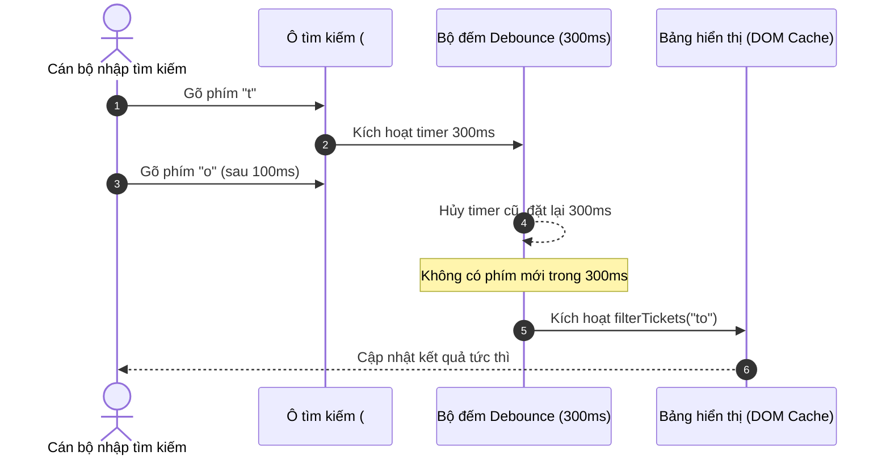

# 🏛️ QUY CHUẨN KỸ THUẬT & TIÊU CHUẨN VIẾT MÃ NGUỒN (FRONTEND & DOCS STANDARDS)
### HỆ THỐNG ĐIỀU HÀNH & CỔNG DỊCH VỤ NỘI BỘ "FAMILY CN23"
> **Đơn vị ban hành:** Văn phòng Đăng ký Đất đai TP.HCM - Chi nhánh số 23  
> **Phạm vi áp dụng:** Toàn bộ mã nguồn Frontend (HTML, CSS, JS) và Tài liệu kỹ thuật (Markdown)  
> **Kiến trúc hệ thống:** Pure Vanilla Web (No Build Step) & Google Apps Script Serverless  
> **Thời điểm ban hành:** Tháng 11/2026 • **Phiên bản:** 2.0 (Official Standard)  
> **Quy chuẩn tối thượng (SSOT):** [`.agent/rules.md`](file:///Users/admin/Desktop/FAMILY_CN23/.agent/rules.md)

---

> [!IMPORTANT]
> **QUY CHUẨN ĐỒNG BỘ VÀ TỐI THƯỢNG:**  
> Tài liệu này đóng vai trò cẩm nang chi tiết và thư viện ví dụ minh họa cho lập trình viên. Đối với AI Agent và quy trình phát triển thực tế, **[`.agent/rules.md`](file:///Users/admin/Desktop/FAMILY_CN23/.agent/rules.md)** là nguồn quy chuẩn **DUY NHẤT VÀ TỐI THƯỢNG**. Mọi quy định chi tiết tại đây luôn đồng thuận và không được phép ghi đè các nguyên tắc trong `.agent/rules.md`.

---

## 📑 MỤC LỤC

1. [TỔNG QUAN VÀ NGUYÊN TẮC CỐT LÕI (CORE PRINCIPLES)](#1-tổng-quan-và-nguyên-tắc-cốt-lõi-core-principles)
2. [QUY CHUẨN TÀI LIỆU MARKDOWN (`.md`) TRONG `docs/`](#2-quy-chuẩn-tài-liệu-markdown-md-trong-docs)
   - 2.1. Vị trí lưu trữ và quy tắc đặt tên file
   - 2.2. Cấu trúc chuẩn của một tài liệu kỹ thuật
   - 2.3. Quy tắc trực quan hóa (Mermaid, Alerts, Tables)
   - 2.4. Nguyên tắc "Docs-as-Code" và bảo trì tài liệu
3. [QUY CHUẨN TẦNG GIAO DIỆN HTML (`.html`)](#3-quy-chuẩn-tầng-giao-diện-html-html)
   - 3.1. Phân tách trách nhiệm (Separation of Concerns)
   - 3.2. Chiến lược nạp tài nguyên & Triệt tiêu Render-Blocking
   - 3.3. Quy tắc Zero-Trust Route Guard & FOUC Prevention
   - 3.4. Semantic HTML5, Form & Chuẩn tiếp cận Accessibility (A11y)
4. [QUY CHUẨN TẦNG ĐỊNH KIỂU CSS (`.css`)](#4-quy-chuẩn-tầng-định-kiểu-css-css)
   - 4.1. Kiến trúc phân tầng (Modular CSS) & No-CDN
   - 4.2. Hệ thống Design Tokens & Nguyên tắc màu 60-30-10
   - 4.3. Đặt tên BEM kết hợp Utility Classes
   - 4.4. Tối ưu hóa hiệu năng Render, Repaint & Tránh Layout Thrashing
   - 4.5. Định dạng in ấn công vụ (`@media print` A4 chuẩn NĐ 30)
5. [QUY CHUẨN TẦNG LOGIC JAVASCRIPT (`.js`)](#5-quy-chuẩn-tầng-logic-javascript-js)
   - 5.1. Kiến trúc Module Vanilla JS & Phân tách trách nhiệm
   - 5.2. Quản lý DOM & Cơ chế Event Delegation bắt buộc
   - 5.3. Tối ưu hóa hiệu năng: Caching, Debounce, Throttle & Tab Hidden
   - 5.4. Xử lý bất đồng bộ kiên cường (Resilient Async/Await & Caching)
   - 5.5. An toàn thông tin: Chống XSS, Formula Injection & Bảo toàn dữ liệu gốc
6. [BẢNG SO SÁNH THỰC TẾ: MÃ LỖI (ANTI-PATTERN) VS. MÃ CHUẨN (BEST PRACTICE)](#6-bảng-so-sánh-thực-tế-mã-lỗi-anti-pattern-vs-mã-chuẩn-best-practice)
7. [BẢNG KIỂM TRA ĐÁNH GIÁ TRƯỚC KHI COMMIT (PRE-FLIGHT CHECKLIST)](#7-bảng-kiểm-tra-đánh-giá-trước-khi-commit-pre-flight-checklist)

---

## 1. TỔNG QUAN VÀ NGUYÊN TẮC CỐT LÕI (CORE PRINCIPLES)

Dự án **Family CN23** phục vụ trực tiếp cho Ban Giám đốc và hơn 80 cán bộ, nhân viên cơ quan Nhà nước trên các máy tính văn phòng sử dụng trình duyệt Chrome/Edge/Cốc Cốc trong môi trường mạng nội bộ. Hệ thống không sử dụng framework nặng (React, Vue, Angular) hay các công cụ biên dịch (Vite, Webpack, Babel) nhằm đảm bảo:
* **Mở trang tức thì (< 200ms - 300ms):** Không có quá trình build/bundle làm chậm trễ.
* **Độ ổn định tối đa:** Chạy độc lập, không phụ thuộc máy chủ trung gian hay CDN quốc tế có nguy cơ bị nghẽn mạng.
* **Bảo toàn 100% đường dẫn tĩnh:** Toàn bộ liên kết GitHub Pages và phím tắt Desktop 1-Click (`.bat`) hoạt động vĩnh viễn không bị gãy link.

Mọi đóng góp mã nguồn (do Lập trình viên hoặc AI Coding Assistant thực hiện) đều phải thỏa mãn **4 Nguyên Tắc Vàng**:

```mermaid
flowchart TD
    A["4 NGUYÊN TẮC VÀNG VỀ MÃ NGUỒN"] --> B["1. Tách Biệt Trách Nhiệm<br/>(Separation of Concerns)"]
    A --> C["2. Hiệu Năng Vượt Trội<br/>(High Performance & Low RAM)"]
    A --> D["3. Bảo Mật Zero-Trust<br/>(Strict Security & Sanitization)"]
    A --> E["4. Chuẩn Hóa Tài Liệu<br/>(Maintainable Docs-as-Code)"]
    
    B --> B1["HTML: Cấu trúc ngữ nghĩa<br/>CSS: Định kiểu tập trung<br/>JS: Logic nghiệp vụ độc lập"]
    C --> C1["Tránh Render-blocking<br/>Event Delegation<br/>DOM Selector Caching<br/>Debounce 300ms"]
    D --> D1["Route Guard tại thẻ head<br/>escapeHtml() chống XSS<br/>Bảo toàn Immutable Master Data"]
    E --> E1["Tập trung 100% tại docs/<br/>Quy chuẩn đặt tên thống nhất<br/>Đồng bộ tài liệu với mã thực tế"]
```



---

## 2. QUY CHUẨN TÀI LIỆU MARKDOWN (`.md`) TRONG `docs/`

Tài liệu là một phần cốt lõi của dự án ("Docs-as-Code"). Để giữ cho thư mục gốc luôn tinh gọn và hỗ trợ tra cứu thông suốt:

### 2.1. Vị trí lưu trữ và quy tắc đặt tên file
* **Vị trí bắt buộc:** Toàn bộ tài liệu phân tích, kiến trúc, quy trình, bảo mật và hướng dẫn kỹ thuật **bắt buộc phải nằm trong thư mục `docs/`**.
  * **Ngoại lệ duy nhất tại thư mục gốc:** Tệp [`README.md`](file:///Users/admin/Desktop/FAMILY_CN23/README.md) đóng vai trò cổng thông tin chính (Landing portal) của dự án.
  * **Ngoại lệ cho AI Assistant:** Tệp [`.agent/rules.md`](file:///Users/admin/Desktop/FAMILY_CN23/.agent/rules.md) lưu trữ các quy tắc điều hướng sinh mã nội bộ.
* **Quy tắc đặt tên file `.md`:**
  * Sử dụng chữ in hoa kết hợp gạch dưới: `UPPERCASE_SNAKE_CASE.md` cho các tài liệu mang tính quy chuẩn hoặc báo cáo chính thức.
    * Ví dụ: `QUY_TRINH_SDLC.md`, `BAO_CAO_AN_NINH.md`, `HUONG_DAN_TRIEN_KHAI.md`, `QUY_CHUAN_MA_NGUON.md`.
  * Tài liệu quản lý đầu việc hoặc danh mục ngắn hạn: `task.md` (chữ thường, thống nhất với workflow).
  * **Tuyệt đối cấm:** Đặt các file tài liệu rải rác ngoài thư mục gốc (`notes.md`, `todo.txt`, `doc1.md`).

### 2.2. Cấu trúc chuẩn của một tài liệu kỹ thuật
Mỗi tài liệu trong `docs/` bắt buộc phải có cấu trúc phân tầng như sau:
1. **Tiêu đề chính (H1 `#`):** Có biểu tượng nhận diện (Emoji) phù hợp với cơ quan hành chính.
2. **Khung Metadata (Trích dẫn Blockquote `>`):**
   * Đơn vị / Cơ quan ban hành.
   * Dự án / Phân hệ áp dụng.
   * Ngày ban hành / cập nhật gần nhất.
   * Tài liệu liên quan hoặc tham chiếu chéo bằng liên kết `[Tên](file:///...)`.
3. **Mục lục (Table of Contents):** Chứa liên kết neo (Anchor links) tương ứng với các tiêu đề mục con.
4. **Phân cấp tiêu đề nghiêm ngặt:**
   * `#` (Cấp 1 - Tiêu đề trang, duy nhất 1 lần đầu file).
   * `##` (Cấp 2 - Chương / Hạng mục lớn).
   * `###` (Cấp 3 - Tiểu mục).
   * `####` (Cấp 4 - Điểm chi tiết, không lạm dụng quá cấp 4).

### 2.3. Quy tắc trực quan hóa
* **Sơ đồ Mermaid:** Bắt buộc sử dụng Mermaid cho các luồng quy trình, kiến trúc dữ liệu và phân tầng module (`flowchart TD`, `flowchart LR`, `sequenceDiagram`).
* **Hộp cảnh báo (GitHub-style Alerts):**
  > [!NOTE]
  > Dùng cho thông tin bổ sung, giải thích kiến trúc hoặc lưu ý cơ bản.
  
  > [!IMPORTANT]
  > Dùng cho các yêu cầu bắt buộc, các bước tiên quyết không thể bỏ qua.
  
  > [!WARNING]
  > Dùng cho cảnh báo bảo mật, nguy cơ mất dữ liệu hoặc xung đột phiên làm việc.
* **Bảng biểu (Markdown Tables):** Mọi bảng dữ liệu phải có dòng tiêu đề, căn lề rõ ràng (`:---`, `:---:`, `---:`), không bỏ trống dòng phân cách.

### 2.4. Nguyên tắc "Docs-as-Code" và bảo trì tài liệu
* Mọi thay đổi kiến trúc hoặc cập nhật tính năng mới **bắt buộc phải cập nhật tài liệu tương ứng đồng thời trong cùng một commit/phiên làm việc**.
* Nghiêm cấm để tài liệu "lệch pha" (out-of-sync) với mã nguồn đang chạy thực tế.
* Các tệp tài liệu cũ không còn giá trị phải được xóa bỏ triệt để, không lưu trữ các file tạm như `README_backup.md`, `RULE_old.md`.

---

## 3. QUY CHUẨN TẦNG GIAO DIỆN HTML (`.html`)

HTML chỉ đảm nhiệm duy nhất một vai trò: **Xây dựng cấu trúc tài liệu ngữ nghĩa (Semantic Structure)**. Không can thiệp vào định kiểu hình ảnh và không chứa mã điều khiển hành vi.

### 3.1. Phân tách trách nhiệm (Separation of Concerns)
* ❌ **CẤM TUYỆT ĐỐI CSS Nội tuyến (Inline CSS):**
  * Không dùng thuộc tính `style="..."` trong bất kỳ thẻ HTML nào (trừ trường hợp cực kỳ hãn hữu do script động gán vị trí tooltip tọa độ X/Y).
  * Không sử dụng thẻ `<style>` bên trong `<body>` hoặc lồng giữa các component.
* ❌ **CẤM TUYỆT ĐỐI Trình lắng nghe sự kiện nội tuyến (Inline Event Handlers):**
  * Cấm hoàn toàn: `<button onclick="submitData()">`, `<select onchange="filterData()">`.
  * Thay vào đó: Sử dụng thuộc tính dữ liệu ngữ nghĩa `data-action="..."`, `data-id="..."` và gán sự kiện từ JavaScript.

### 3.2. Chiến lược nạp tài nguyên & Triệt tiêu Render-Blocking
Để trang web mở ngay trong tích tắc mà không bị trắng màn hình (Blank White Screen):
* **Nạp CSS trong thẻ `<head>`:**
  * Nạp theo đúng thứ tự phân tầng từ cơ bản đến chuyên biệt:
    ```html
    <!-- 1. Design Tokens & Biến màu toàn hệ thống -->
    <link rel="stylesheet" href="css/variables.css">
    <!-- 2. Khung App Shell, Reset & Topbar chuẩn -->
    <link rel="stylesheet" href="css/base.css">
    <!-- 3. Bộ tiện ích tĩnh dùng chung (thay thế Tailwind) -->
    <link rel="stylesheet" href="css/utilities.css">
    <!-- 4. Giao diện chuyên biệt của phân hệ -->
    <link rel="stylesheet" href="css/it_helpdesk.css">
    ```
* **Nạp JavaScript với thuộc tính `defer`:**
  * Toàn bộ các script giao diện, tiện ích, thư viện và logic phân hệ đặt trong `<head>` phải có thuộc tính `defer` để trình duyệt tải song song mà không block quá trình dựng cây DOM:
    ```html
    <script src="js/layout.js" defer></script>
    <script src="js/it_helpdesk.js" defer></script>
    ```

### 3.3. Quy tắc Zero-Trust Route Guard & FOUC Prevention
> [!IMPORTANT]
> **Ngoại lệ duy nhất cho đoạn script nội tuyến trong `<head>`:**
> Nhằm bảo vệ an toàn thông tin cơ quan, ngăn chặn người ngoài xem trộm giao diện khi chưa đăng nhập và chống nhấp nháy giao diện (Flash of Unstyled Content - FOUC), mọi trang phân hệ con (`lich_tuan.html`, `it_helpdesk.html`, `giao_viec.html`, `bao_cao_to.html`) **bắt buộc phải nhúng module `js/auth.js` và gọi hàm `requireAuth()` ngay đầu thẻ `<head>`**:

```html
<head>
  <meta charset="UTF-8">
  <meta name="viewport" content="width=device-width, initial-scale=1.0">
  <title>Phân Hệ Nghiệp Vụ - VPĐK Chi Nhánh 23</title>

  <!-- Route Guard chạy tức thì trước khi nạp DOM/CSS để bảo vệ trang -->
  <script src="js/auth.js"></script>
  <script>FamilyAuth.requireAuth();</script>

  <!-- Các liên kết CSS và script defer phía dưới -->
  ...
</head>
```
Đoạn mã này thực thi đồng bộ chỉ trong < 1ms: nếu không có session `family_user` hợp lệ, lệnh `window.location.replace("index.html")` lập tức kích hoạt, chấm dứt việc render trang con ngay từ đầu.

### 3.4. Semantic HTML5, Form & Accessibility (A11y)
* **Cấu trúc ngữ nghĩa rõ ràng:**
  * Sử dụng thẻ chuẩn: `<header>`, `<main class="main-content">`, `<section>`, `<article>`, `<aside>`, `<footer>`.
  * Tránh "lạm phát thẻ div" (Div Soup) với 7-8 cấp lồng nhau không có ý nghĩa ngữ nghĩa.
* **Quy chuẩn Form & Nhập liệu:**
  * Mỗi trường `<input>`, `<select>`, `<textarea>` bắt buộc có thẻ `<label for="id-tuong-ung">` đi kèm.
  * Phải có thuộc tính `autocomplete` phù hợp (`autocomplete="username"`, `autocomplete="current-password"`, `autocomplete="off"`).
  * Các nút hành động chính phải có `type="button"` hoặc `type="submit"` rõ ràng, không để mặc định.

---

## 4. QUY CHUẨN TẦNG ĐỊNH KIỂU CSS (`.css`)

CSS định hình toàn bộ phong cách thị giác trang trọng, uy nghiêm của cơ quan hành chính Nhà nước. Phải đảm bảo không phụ thuộc đường truyền ngoài và tốc độ tính toán render nhanh nhất.

### 4.1. Kiến trúc phân tầng (Modular CSS) & No-CDN
Toàn bộ mã CSS nằm gọn trong thư mục `css/`:
* `css/variables.css`: Khai báo Design Tokens, màu sắc, khoảng cách, bóng đổ.
* `css/base.css`: CSS Reset tinh gọn, chuẩn typography cơ quan (Inter, Segoe UI, Roboto, Times New Roman cho văn bản), App Shell (Topbar 62px, Footer cố định).
* `css/utilities.css`: Bộ class tiện ích (Flex, Grid, Margin, Padding, Text Alignment, Colors) được xây dựng tĩnh nội bộ để **loại trừ 100% sự phụ thuộc vào Tailwind CDN**.
* `css/[ten_phan_he].css`: Bảng định kiểu chuyên biệt của từng phân hệ (`hub.css`, `lich_tuan.css`, `it_helpdesk.css`, `giao_viec.css`, `bao_cao_to.css`).
* **Tuyệt đối không nhúng CDN bên ngoài** (như Tailwind CDN, Bootstrap CDN). Nếu cần thư viện ngoại tuyến (như `flatpickr.min.css`), phải tải file về lưu trực tiếp trong thư mục `css/`.

### 4.2. Hệ thống Design Tokens & Nguyên tắc màu 60-30-10
Bắt buộc tuân thủ nguyên tắc phối màu công vụ:
* **60% Nền & Không gian:** Nền xám dịu mắt (`var(--color-bg-app): #f8fafc`) và Nền thẻ trắng tinh (`var(--color-bg-surface): #ffffff`).
* **30% Nhận diện cơ quan:** Xanh hoàng gia Royal Navy (`var(--color-brand-navy): #1e3a8a`, `var(--color-brand-navy-dark): #0f172a`) dùng cho Topbar Header, tiêu đề Card, đường viền bảng.
* **10% Điểm nhấn hành động:** Vàng kim công vụ (`var(--color-accent): #d97706`, `var(--color-accent-hover): #b45309`) **CHỈ DÙNG** cho nút bấm hành động chính (CTA - Thêm mới, Gửi sự cố, Đăng ký), Badge nổi bật và trạng thái khẩn cấp.

> [!CAUTION]
> **Nghiêm cấm gán cứng mã màu HEX tùy tiện:** Mọi màu sắc mới phát sinh bắt buộc phải sử dụng các biến CSS `var(--color-...)` đã được khai báo trong [`css/variables.css`](file:///Users/admin/Desktop/FAMILY_CN23/css/variables.css).

### 4.3. Đặt tên BEM kết hợp Utility Classes
* Đặt tên theo chuẩn BEM tinh gọn:
  * Block: `.ticket-card`, `.schedule-table`, `.modal-dialog`
  * Element: `.ticket-card__header`, `.ticket-card__title`, `.ticket-card__actions`
  * Modifier: `.ticket-card--urgent`, `.btn--primary`, `.status-badge--success`
* Phối hợp linh hoạt với utility classes trong `css/utilities.css` cho các thuộc tính bố cục (`d-flex`, `justify-between`, `items-center`, `gap-2`, `mb-3`, `text-center`).

### 4.4. Tối ưu hóa hiệu năng Render, Repaint & Tránh Layout Thrashing
* **Giảm độ sâu Selector (Low Specificity):**
  * Tối đa 2 đến 3 cấp selector. Cấm viết selector quá sâu gây tốn bộ nhớ trình duyệt khi đối chiếu:
    * ❌ Sai: `body main.main-content .container div.card div.card-body button.btn-save`
    * ✅ Đúng: `.card .btn-save` hoặc `.btn-save`
* **Tuyệt đối hạn chế `!important`:** Chỉ dùng `!important` trong `css/utilities.css` cho các trạng thái bắt buộc ẩn/hiển thị (ví dụ `.d-none { display: none !important; }`).
* **Tối ưu thuộc tính chuyển động (Transitions & Animations):**
  * Chỉ animate 2 thuộc tính phần cứng: `transform` và `opacity`.
  * Cấm animate các thuộc tính kích hoạt Layout Reflow như `top`, `left`, `width`, `height`, `margin`, `padding`.
* **Áp dụng `content-visibility` cho bảng dữ liệu lớn:**
  * Với các bảng danh sách dài hơn 50 hàng:
    ```css
    .table-row-item {
      content-visibility: auto;
      contain-intrinsic-size: 0 48px;
    }
    ```
    Giúp trình duyệt bỏ qua việc tính toán render các hàng nằm ngoài màn hình xem, giảm thời gian render ban đầu từ 200ms xuống dưới 20ms.

### 4.5. Định dạng in ấn công vụ (`@media print` A4 chuẩn NĐ 30)
Mọi phân hệ khi xuất bản in hoặc người dùng bấm `Ctrl + P` phải có khối CSS in ấn chuẩn:
```css
@media print {
  /* 1. Ẩn toàn bộ thanh điều hướng, nút bấm, footer */
  .topbar, .user-dropdown, .btn, .filter-toolbar, .no-print {
    display: none !important;
  }
  
  /* 2. Thiết lập trang giấy A4 chuẩn Nghị định 30/2020 */
  @page {
    size: A4 portrait;
    margin: 20mm 15mm 20mm 30mm; /* Trên, Phải, Dưới, Trái */
  }

  body {
    background: #ffffff !important;
    color: #000000 !important;
    font-family: "Times New Roman", Times, serif !important;
    font-size: 13pt !important;
  }
}
```

---

## 5. QUY CHUẨN TẦNG LOGIC JAVASCRIPT (`.js`)

JavaScript vận hành toàn bộ nghiệp vụ tương tác, xử lý luồng dữ liệu hai chiều với Google Apps Script và cập nhật giao diện mà không reload trang.

### 5.1. Kiến trúc Module Vanilla JS & Phân tách trách nhiệm
Mỗi file `.js` chỉ đảm nhiệm duy nhất một vai trò theo nguyên tắc Single Responsibility:
* `js/auth.js`: Quản lý phiên đăng nhập (`family_user`), lưu trữ `sessionStorage`, cơ chế kiểm soát Route Guard, phân quyền quản trị IT dung sai cao.
* `js/layout.js`: Quản trị App Shell (khởi tạo Topbar 62px đồng bộ 5 phân hệ, User Dropdown góc phải, Toast Notifications toàn trang).
* `js/api.js` *(nếu tách riêng)* hoặc API Gateway: Định nghĩa tập trung URL Google Apps Script Web App và các phương thức giao tiếp mạng.
* `js/utils.js`: Các hàm trợ năng dùng chung (`escapeHtml`, `formatDisplayDate`, `formatDisplayTime`, `debounce`, `throttle`, `removeVietnameseTones`).
* `js/[phan_he].js` (hoặc `js/app.js`): Logic nghiệp vụ riêng của từng phân hệ (form submission, DOM rendering, modal control).

### 5.2. Quản lý DOM & Cơ chế Event Delegation bắt buộc
Trong các phân hệ có bảng danh sách dữ liệu động lớn (80 cán bộ, hàng trăm sự cố IT hoặc báo cáo chỉ tiêu):
* ❌ **CẤM TUYỆT ĐỐI gán sự kiện riêng rẽ trong vòng lặp:**
  * Không dùng `querySelectorAll('.btn-edit').forEach(btn => btn.addEventListener(...))` sau mỗi lần render. Hành vi này gây rò rỉ bộ nhớ (Memory Leak) và làm đơ trình duyệt khi dữ liệu lớn.
* ✅ **BẮT BUỘC áp dụng Kỹ thuật Ủy quyền sự kiện (Event Delegation):**
  * Gán một listener duy nhất lên phần tử cha cố định (ví dụ `tbody` của bảng hoặc container thẻ):

```javascript
// ✅ Chuẩn mực: Chỉ 1 Event Listener duy nhất cho toàn bộ bảng dữ liệu
const ticketTableBody = document.getElementById("ticketTableBody");

if (ticketTableBody) {
  ticketTableBody.addEventListener("click", (event) => {
    // Tìm phần tử mang thuộc tính data-action gần nhất
    const targetBtn = event.target.closest("[data-action]");
    if (!targetBtn) return;

    const action = targetBtn.dataset.action;
    const ticketId = targetBtn.dataset.id;

    if (action === "edit") {
      openEditModal(ticketId);
    } else if (action === "delete") {
      confirmDeleteTicket(ticketId);
    } else if (action === "view-detail") {
      viewTicketDetail(ticketId);
    }
  });
}
```

### 5.3. Tối ưu hóa hiệu năng: Caching, Debounce, Throttle & Tab Hidden



1. **Bộ nhớ đệm phần tử DOM (DOM Caching):**
   * Lưu các selector thường dùng vào biến hoặc đối tượng bộ nhớ đệm, tránh gọi `document.getElementById` lặp lại nhiều lần trong các hàm tính toán:
   ```javascript
   const DOM = {
     tableBody: document.getElementById("ticketTableBody"),
     statusFilter: document.getElementById("statusFilter"),
     searchInput: document.getElementById("searchInput"),
     totalCounter: document.getElementById("totalCountBadge")
   };
   ```
2. **Kỹ thuật Debounce cho ô tìm kiếm & lọc dữ liệu:**
   * Mọi ô nhập tìm kiếm gõ phím (`input`) phải được debounce tối thiểu **300ms** trước khi thực hiện lọc dữ liệu:
   ```javascript
   function debounce(func, delay = 300) {
     let timeoutId;
     return function (...args) {
       clearTimeout(timeoutId);
       timeoutId = setTimeout(() => func.apply(this, args), delay);
     };
   }

   DOM.searchInput.addEventListener("input", debounce((e) => {
     handleSearchFilter(e.target.value.trim());
   }, 300));
   ```
3. **Cập nhật DOM theo đợt (Batch DOM Updating):**
   * Khi render danh sách nhiều hàng, tạo chuỗi HTML tổng hợp hoặc dùng `DocumentFragment` rồi gán vào DOM 1 lần duy nhất (`DOM.tableBody.innerHTML = fullHtmlString;`), không gọi `.appendChild()` liên tục trong vòng lặp.
4. **Tiết kiệm tài nguyên khi Tab chạy ngầm (Inactive Tab CPU Saving):**
   * Các tiến trình hẹn giờ tự động (`setInterval` lấy dữ liệu mới từ Google Sheets) bắt buộc phải kiểm tra trạng thái tab đang mở:
   ```javascript
   setInterval(() => {
     // Nếu cán bộ chuyển sang tab khác làm việc, dừng ngay việc gọi máy chủ để tiết kiệm CPU và RAM
     if (document.hidden) return;
     syncDataSilently();
   }, 60000); // 1 phút
   ```

### 5.4. Xử lý bất đồng bộ kiên cường (Resilient Async/Await & Caching)
* **100% lệnh gọi API dùng `async/await` với khối `try...catch`:**
  * Tuyệt đối không để ứng dụng âm thầm gặp sự cố mà không có thông báo cho người dùng.
* **Giao diện phản hồi trực quan (Visual UX Feedback):**
  * Do Google Apps Script có độ trễ mạng (800ms - 2s), mọi thao tác gửi dữ liệu hoặc tải danh sách **bắt buộc phải có Skeleton Loading hoặc Spinner** và khóa nút bấm (`btn.disabled = true;`) để chống người dùng nhấp đúp (Double-Click Spam).
* **Bộ nhớ đệm Client (Client-Side Caching):**
  * Dữ liệu danh mục ít thay đổi (danh bạ cán bộ, danh sách tổ nghiệp vụ) phải được lưu vào `sessionStorage` kèm dấu thời gian kiểm tra (TTL 5 - 10 phút) để tránh gọi máy chủ liên tục mỗi khi chuyển trang.

### 5.5. An toàn thông tin: Chống XSS, Formula Injection & Bảo toàn dữ liệu gốc
1. **Chống tấn công XSS:** Mọi dữ liệu do người dùng nhập hoặc nhận từ server chèn vào `innerHTML` bắt buộc phải qua hàm `escapeHtml()`:
   ```javascript
   function escapeHtml(str) {
     if (!str) return "";
     return String(str)
       .replace(/&/g, "&amp;")
       .replace(/</g, "&lt;")
       .replace(/>/g, "&gt;")
       .replace(/"/g, "&quot;")
       .replace(/'/g, "&#039;");
   }
   ```
2. **Bảo toàn Mảng Dữ Liệu Gốc (Immutable Master Data):**
   * Mảng dữ liệu tải về từ máy chủ (`rawServerTickets` / `rawMasterData`) phải được lưu trữ bất biến. Mọi thao tác lọc theo quyền hạn, tìm kiếm từ khóa hoặc phân trang chỉ được thực hiện trên mảng hiển thị dẫn xuất (`currentTickets`).
   * ❌ CẤM: `rawServerTickets = rawServerTickets.filter(...)` làm mất vĩnh viễn dữ liệu của người khác trong phiên làm việc.
3. **Chống chèn mã công thức Google Sheets (Formula Injection):**
   * Dữ liệu gửi lên Backend Google Sheets bắt buộc thêm dấu `'` ở đầu nếu bắt đầu bằng các ký tự nguy hiểm: `=`, `+`, `-`, `@`.

---

## 6. BẢNG SO SÁNH THỰC TẾ: MÃ LỖI (ANTI-PATTERN) VS. MÃ CHUẨN (BEST PRACTICE)

### 6.1. Tầng HTML & Script Loading

| Tiêu chí | ❌ Mã lỗi / Vi phạm thực tế (Anti-Pattern) | ✅ Mã chuẩn quy cách (Best Practice) |
|---|---|---|
| **Nạp Script ứng dụng** | `<script src="js/app.js"></script>` ở giữa trang gây block parser khiến trang trắng bệch. | `<script src="js/app.js" defer></script>` đặt trong thẻ `<head>`, trình duyệt nạp song song. |
| **Sự kiện bấm nút** | `<button class="btn" onclick="deleteTicket('123')">Xóa</button>` | `<button class="btn" data-action="delete" data-id="123">Xóa</button>` |
| **Định kiểu nhanh** | `<div style="color: red; margin-top: 10px; font-weight: bold;">Cảnh báo</div>` | `<div class="text-danger mt-2 font-bold">Cảnh báo</div>` (sử dụng utility class trong `css/utilities.css`). |
| **Kiểm soát truy cập** | Kiểm tra quyền ở cuối file HTML làm giao diện nhấp nháy rồi mới chuyển trang (FOUC). | Nhúng `<script src="js/auth.js"></script><script>FamilyAuth.requireAuth();</script>` ngay đầu `<head>`. |

### 6.2. Tầng JavaScript & Hiệu năng

| Tiêu chí | ❌ Mã lỗi / Vi phạm thực tế (Anti-Pattern) | ✅ Mã chuẩn quy cách (Best Practice) |
|---|---|---|
| **Lắng nghe sự kiện bảng** | `items.forEach(item => {`<br>`  document.getElementById('btn-' + item.id).addEventListener('click', ...);`<br>`});` (Gây tràn RAM khi có 100+ items). | Gán 1 listener duy nhất trên `tableBody`: <br>`tableBody.addEventListener('click', (e) => {`<br>`  const btn = e.target.closest('[data-action]'); ...`<br>`});` |
| **Tìm kiếm khi gõ phím** | Gọi hàm lọc hoặc gọi API ngay lập tức trong sự kiện `oninput` (gọi hàng chục lần khi gõ 1 từ). | Bọc qua hàm `debounce(fn, 300)` để chỉ thực thi khi người dùng đã dừng gõ phím 300ms. |
| **Chèn chuỗi vào DOM** | `container.innerHTML += '<div>' + item.title + '</div>'` (Lỗ hổng XSS nghiêm trọng, liên tục phá hủy và dựng lại cây DOM). | `const safeHtml = escapeHtml(item.title);`<br>Gộp mảng chuỗi hoàn chỉnh rồi gán `container.innerHTML = fullHtml;` 1 lần duy nhất. |
| **Xử lý cuộc gọi API** | `fetch(url).then(r => r.json()).then(d => show(d));`<br>(Không bắt lỗi mạng, giao diện đứng hình nếu mạng rớt). | Dùng `async/await` kết hợp `try...catch`, hiển thị spinner khi nạp và Toast thông báo rõ ràng khi gặp sự cố. |

---

## 7. BẢNG KIỂM TRA ĐÁNH GIÁ TRƯỚC KHI COMMIT (PRE-FLIGHT CHECKLIST)

Mọi kỹ sư hoặc AI Coding Assistant trước khi bàn giao một tính năng mới, tạo trang HTML mới hoặc refactor mã nguồn **bắt buộc phải tự kiểm tra và đạt 100% các tiêu chí dưới đây**:

```text
[ ] 1. TÀI LIỆU (MARKDOWN)
    [ ] Toàn bộ tài liệu kỹ thuật nằm trong docs/ (đặt tên UPPERCASE_SNAKE_CASE.md).
    [ ] Tài liệu có đầy đủ H1, Metadata trích dẫn, Mục lục và phân cấp tiêu đề logic.
    [ ] Sử dụng sơ đồ Mermaid cho các luồng quy trình phức tạp.

[ ] 2. TẦNG GIAO DIỆN (HTML)
    [ ] File phân hệ con có Route Guard trong <head>: FamilyAuth.requireAuth().
    [ ] Toàn bộ script nghiệp vụ đều có thuộc tính defer trong thẻ <head>.
    [ ] 100% không còn thuộc tính style="..." nội tuyến (trừ tọa độ X/Y tooltip).
    [ ] 100% không còn sự kiện inline: onclick, onchange, onsubmit.
    [ ] Form nhập liệu có đầy đủ <label for="...">, autocomplete và type nút bấm.

[ ] 3. TẦNG ĐỊNH KIỂU (CSS)
    [ ] Không nạp bất kỳ CDN nào (loại bỏ hoàn toàn Tailwind CDN hoặc Bootstrap CDN).
    [ ] Nạp đầy đủ bộ khung: variables.css -> base.css -> utilities.css -> [module].css.
    [ ] Sử dụng biến CSS chuẩn trong css/variables.css, không tự ý thêm mã HEX ngẫu nhiên.
    [ ] Không lạm dụng !important; độ sâu selector không quá 3 cấp.
    [ ] Có khối định dạng in ấn @media print chuẩn khổ giấy A4 theo Nghị định 30/2020.

[ ] 4. TẦNG LOGIC (JAVASCRIPT)
    [ ] 100% danh sách dữ liệu động áp dụng Event Delegation trên phần tử cha.
    [ ] Các ô tìm kiếm và bộ lọc gõ phím đều được debounce tối thiểu 300ms.
    [ ] Có if (document.hidden) return; trong các bộ đếm thời gian setInterval.
    [ ] 100% dữ liệu chèn vào innerHTML đều được bọc qua hàm escapeHtml().
    [ ] Mảng dữ liệu nguồn (rawMasterData) được giữ nguyên vẹn, không filter đè lên nguồn.
    [ ] Mọi cuộc gọi bất đồng bộ fetch đều nằm trong try/catch và có trạng thái loading/toast.
```

---
*Tài liệu này là quy chuẩn kỹ thuật chính thức của dự án "Family CN23". Mọi hành vi cố tình vi phạm hoặc bỏ qua các tiêu chuẩn trên đều phải được từ chối sáp nhập (Reject Pull Request).*
