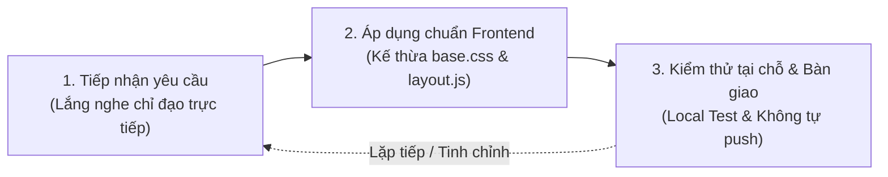

# 🏛️ QUY TRÌNH PHÁT TRIỂN PHẦN MỀM & KẾ HOẠCH BẢO MẬT - HIỆU NĂNG "FAMILY CN23"

> **Cơ quan:** Văn phòng Đăng ký Đất đai TP.HCM - Chi nhánh số 23  
> **Dự án:** Hệ thống Cổng Dịch Vụ Cán Bộ & Điều Hành Nội Bộ "Family CN23"  
> **Quy mô phục vụ:** Toàn thể Ban Giám đốc và hơn 80 cán bộ, viên chức, người lao động Chi nhánh 23  
> **Thời điểm cập nhật:** Tháng 11/2026 (Phiên bản đồng bộ Agile Frontend)  
> **Quy chuẩn tối thượng (SSOT):** [`.agent/rules.md`](file:///Users/admin/Desktop/FAMILY_CN23/.agent/rules.md)

---

> [!IMPORTANT]
> **THÔNG BÁO VỀ QUY TRÌNH PHÁT TRIỂN (AGILE FRONTEND WORKFLOW):**  
> Dự án **KHÔNG áp dụng mô hình Thác nước (Waterfall)** cứng nhắc và không yêu cầu các bước lập tài liệu đặc tả (Spec/Analysis/Design) cồng kềnh trước khi thực hiện. Toàn bộ quy trình sinh mã, sửa đổi giao diện và tiêu chuẩn kỹ thuật được hợp nhất duy nhất tại **[`.agent/rules.md`](file:///Users/admin/Desktop/FAMILY_CN23/.agent/rules.md)**. Tài liệu này lưu trữ kết quả rà soát an ninh và danh mục task bảo mật lịch sử.

---

## 📑 MỤC LỤC
1. [QUY TRÌNH PHÁT TRIỂN LINH HOẠT (AGILE FRONTEND PAIR-PROGRAMMING)](#1-quy-trình-phát-triển-linh-hoạt-agile-frontend-pair-programming)
2. [KẾT QUẢ RÀ SOÁT TOÀN DIỆN HỆ THỐNG (FULL CODEBASE AUDIT)](#2-kết-quả-rà-soát-toàn-diện-hệ-thống-full-codebase-audit)
   - [2.1. Đánh giá An toàn thông tin & Kiểm soát truy cập Module (Security)](#21-đánh-giá-an-toàn-thông-tin--kiểm-soát-truy-cập-module-security)
   - [2.2. Đánh giá Code dư thừa, Mã mồ côi & Vi phạm Best Practice (Clean Code)](#22-đánh-giá-code-dư-thừa-mã-mồ-côi--vi-phạm-best-practice-clean-code)
   - [2.3. Đánh giá Hiệu năng, Bộ nhớ & Tải trang trên máy tính cơ quan (Performance)](#23-đánh-giá-hiệu-năng-bộ-nhớ--tải-trang-trên-máy-tính-cơ-quan-performance)
3. [DANH MỤC CÁC TASK CẦN THỰC THI (ACTIONABLE TASKS BREAKDOWN)](#3-danh-mục-các-task-cần-thực-thi-actionable-tasks-breakdown)
   - [Nhóm Task 1: Bảo mật Khẩn cấp - Chặn truy cập trái phép vào các Phân hệ (P0)](#nhóm-task-1-bảo-mật-khẩn-cấp---chặn-truy-cập-trái-phép-vào-các-phân-hệ-p0)
   - [Nhóm Task 2: Dọn dẹp Mã dư thừa, Tài nguyên trùng lặp & Chống rò rỉ PII (P1)](#nhóm-task-2-dọn-dẹp-mã-dư-thừa-tài-nguyên-trùng-lặp--chống-rò-rỉ-pii-p1)
   - [Nhóm Task 3: Bẻ gãy phụ thuộc Tailwind CDN & Tăng tốc độ nạp trang (P1)](#nhóm-task-3-bẻ-gãy-phụ-thuộc-tailwind-cdn--tăng-tốc-độ-nạp-trang-p1)
   - [Nhóm Task 4: Củng cố Backend Google Apps Script & Chống XSS / Formula Injection (P2)](#nhóm-task-4-củng-cố-backend-google-apps-script--chống-xss--formula-injection-p2)
   - [Nhóm Task 5: Xây dựng Bộ Kiểm Thử Tự Động (Dev & Test Pipeline) (P2)](#nhóm-task-5-xây-dựng-bộ-kiểm-thử-tự-động-dev--test-pipeline-p2)
4. [QUY CHUẨN COMMIT & QUẢN TRỊ DỰ ÁN TRÊN GIT](#4-quy-chuẩn-commit--quản-trị-dự-án-trên-git)

---

## 1. QUY TRÌNH PHÁT TRIỂN LINH HOẠT (AGILE FRONTEND PAIR-PROGRAMMING)

Để tối ưu hóa thời gian triển khai và bám sát nhu cầu thực tế của Quản trị viên và hơn 80 cán bộ Chi nhánh 23, quy trình phát triển được tinh gọn thành **3 bước lặp trực tiếp**:



### Các nguyên tắc cốt lõi:
1. **Không lập đặc tả rườm rà (No Spec Overhead):** Không yêu cầu tài liệu phân tích nghiệp vụ hay mockup hình ảnh phức tạp trước khi lập trình.
2. **Kế thừa bộ khung nền tảng:** Mọi tính năng kế thừa `layout.js`, `auth.js`, `base.css` và biến màu `variables.css`.
3. **Kỷ luật Git nghiêm ngặt (Quy tắc 9):** Tuyệt đối **KHÔNG tự ý chạy `git push`** khi chưa có sự đồng ý rõ ràng từ Quản trị viên.
4. **Chi tiết toàn diện:** Tra cứu tại [`.agent/rules.md`](file:///Users/admin/Desktop/FAMILY_CN23/.agent/rules.md).

---

## 2. KẾT QUẢ RÀ SOÁT TOÀN DIỆN HỆ THỐNG (FULL CODEBASE AUDIT)

Sau khi quét toàn bộ thư mục dự án, dưới đây là chi tiết các vấn đề được phát hiện:

### 2.1. Đánh giá An toàn thông tin & Kiểm soát truy cập Module (Security)
1. **Lỗ hổng Bỏ Lọt Kiểm Tra Đăng Nhập Trên 2 Phân Hệ Cốt Lõi (CRITICAL):**
   - **Hiện trạng:**
     - Tại [`giao_viec.html`](file:///Users/admin/Desktop/FAMILY_CN23/giao_viec.html#L675-L695): Hàm `initUserSession()` chỉ cố gắng lấy `currentUser` để điền tên vào header. Nếu không có session, **hàm không làm gì cả và không hề chuyển hướng**.
     - Tại [`bao_cao_to.html`](file:///Users/admin/Desktop/FAMILY_CN23/bao_cao_to.html#L570-L592): Tương tự, nếu không có session, trang vẫn mở bình thường.
   - **Hậu quả:** Bất kỳ ai ngoài cơ quan mở trực tiếp link `giao_viec.html` hoặc `bao_cao_to.html` đều có thể vào xem toàn bộ danh mục chỉ đạo của Lãnh đạo, xem báo cáo số liệu chuyên môn, thậm chí ấn tạo/xóa task và nhập báo cáo giả mạo.
   - **Yêu cầu của người dùng:** *"Họ không thể nào vào các module nếu như không có đăng nhập."* -> Cần khóa bảo vệ chặn tức thì tại thẻ `<head>` của tất cả các trang con.

2. **Xung đột & Bất nhất Khóa Phiên Làm Việc (Session Key Chaos):**
   - `index.html` lưu đồng thời 3 khóa: `binhduong_user`, `vpdk_current_user`, `currentUser`.
   - `giao_viec.html` & `bao_cao_to.html` chỉ đọc và xóa `currentUser`.
   - `it_helpdesk.html` đọc và xóa `binhduong_user` & `vpdk_current_user`.
   - `layout.js` đọc thử 5 khóa khác nhau (`currentUser`, `binhduong_user`, `vpdk_current_user`, `currentStaff`, `userName`).
   - Khi cán bộ bấm "Đăng xuất" ở `giao_viec.html`, khóa `binhduong_user` vẫn còn nguyên, dẫn tới việc vào lại `it_helpdesk.html` thì vẫn hiển thị đã đăng nhập (phiên ma).

3. **Lộ lọt Danh bạ & Ghi chú Nhân sự Nhạy cảm trên Git Công Khai (HIGH):**
   - [`js/app.js`](file:///Users/admin/Desktop/FAMILY_CN23/js/app.js#L41-L118): Chứa mảng `KNOWN_USERS_MAP` với số điện thoại cá nhân và tên của hơn 70 cán bộ.
   - [`giao_viec.html`](file:///Users/admin/Desktop/FAMILY_CN23/giao_viec.html#L524-L640): Chứa mảng `STAFF_CN23` với 82 cán bộ kèm các ghi chú nội bộ nhạy cảm (*"Xin nghỉ việc 01/11/2026"*, *"Thử việc đến 01/11/2026"*, *"Chuyển từ CN28"*...).
   - [`backend/google_apps_script.js`](file:///Users/admin/Desktop/FAMILY_CN23/backend/google_apps_script.js#L660-L705): API `action=getUsers` cho phép bất kỳ ai gửi GET request để tải về toàn bộ danh bạ kèm **Số CCCD**.

4. **Truyền tải và lưu Mật khẩu thô (Plaintext Credentials) (HIGH):**
   - [`index.html`](file:///Users/admin/Desktop/FAMILY_CN23/index.html#L609): Luồng fallback tự động nối chuỗi mật khẩu vào URL GET `?action=login&username=...&password=...`.
   - Mật khẩu lưu dạng văn bản thô trên cột C của tab `TaiKhoan` Google Sheet, so sánh trực tiếp `rowPass === password`.

5. **Lỗ hổng Stored XSS và Attribute Injection (HIGH):**
   - Dữ liệu người dùng nhập trong `giao_viec.html` (`${t.title}`, `${t.guidance}`, `${t.leader}`), `bao_cao_to.html` và `it_helpdesk.html` được nội suy thẳng vào chuỗi template `innerHTML` mà không qua hàm lọc ký tự đặc biệt `escapeHtml()`.
   - Các thuộc tính sự kiện inline như `onclick="markTaskDone('${t.id}')"` có nguy cơ bị phá vỡ thuộc tính HTML nếu ID chứa dấu nháy.

6. **Google Drive Phân Quyền Công Khai Quá Mức (MEDIUM):**
   - [`backend/google_apps_script.js`](file:///Users/admin/Desktop/FAMILY_CN23/backend/google_apps_script.js#L470, #L490): Thiết lập thư mục upload và từng file ở chế độ `DriveApp.Access.ANYONE_WITH_LINK`. Ảnh chụp màn hình máy tính có thể chứa thông tin thửa đất, giấy tờ nhà đất của công dân.

---

### 2.2. Đánh giá Code dư thừa, Mã mồ côi & Vi phạm Best Practice (Clean Code)
1. **Các file mã nguồn bị bỏ rơi (Orphan / Dead Files):**
   - [`css/style.css`](file:///Users/admin/Desktop/FAMILY_CN23/css/style.css): Dài **2.446 dòng** (~85 KB). Không một file HTML nào trong dự án nhúng file này (các trang đã chuyển sang `css/hub.css`, `css/lich_tuan.css`, `css/giao_viec.css`, `css/bao_cao_to.css`, `css/it_helpdesk.css`).
   - [`css/sidebar.css`](file:///Users/admin/Desktop/FAMILY_CN23/css/sidebar.css): Dài **528 dòng** (~16 KB). File này thuộc về menu sidebar cũ đã bị thay thế hoàn toàn bởi Topbar trong `layout.js`.
   - [`js/sidebar.js`](file:///Users/admin/Desktop/FAMILY_CN23/js/sidebar.js): Dài **306 dòng** (~11 KB). Không file HTML nào nhúng.
   - `base_template.html` (thư mục gốc) và `templates/base_app_template.html`: Hai file giống nhau 100%, gây phân tán bảo trì.

2. **Tài nguyên tải về bị trùng lặp dung lượng (Asset Duplication):**
   - `Family_CN23_Desktop.zip` ở thư mục gốc (525 KB) và `assets/installer/Family_CN23_Desktop.zip` (525 KB): Giống nhau 100%.
   - `assets/installer/Cai_Dat_Family_CN23.bat` (115 KB) và `assets/installer/Tao_Icon_Desktop_VPDK23.bat` (115 KB): Giống nhau 100%.
   - `pikachu_badge.ico` tồn tại đồng thời ở 3 vị trí khác nhau.

3. **Dữ liệu danh ngôn vĩ nhân quá nặng làm chậm trang chủ:**
   - [`js/quotes_data.js`](file:///Users/admin/Desktop/FAMILY_CN23/js/quotes_data.js): Dài **6.716 dòng**, nặng **347 KB**, chứa 610 câu nói.
   - Trong `index.html`, script này được nạp bằng thẻ `<script src="js/quotes_data.js"></script>` ở chế độ đồng bộ (blocking). Trình duyệt của cán bộ phải tải hết 347 KB này trước khi render form đăng nhập, chỉ để chọn ngẫu nhiên 1 câu nói.

4. **Biến và logic không sử dụng trong mã nguồn:**
   - Trong `js/app.js`: Biến `INITIAL_DEMO_SCHEDULE` (mảng rỗng), biến `ADMIN_EMAIL` cũ, hàm `calculateDayOfWeek` có đoạn xử lý thừa do Flatpickr đã xử lý.
   - Biến `attachedFileInfo` trong `giao_viec.html` không được giải phóng bộ nhớ khi đóng modal.

---

### 2.3. Đánh giá Hiệu năng, Bộ nhớ & Tải trang trên máy tính cơ quan (Performance)
1. **Lạm dụng Tailwind Play CDN trên môi trường Production:**
   - `giao_viec.html`, `bao_cao_to.html`, `it_helpdesk.html` đều nạp `<script src="https://cdn.tailwindcss.com"></script>`.
   - Script này nặng gần 3MB, quét toàn bộ cây DOM trong thời gian thực để biên dịch CSS (Client-side JIT).
   - Trên các máy tính văn phòng Core i3 thế hệ cũ, RAM 4GB tại Chi nhánh 23, script này làm CPU tăng vọt 100%, gây giật lag 1-3 giây khi mở trang và làm vỡ tan giao diện nếu mạng cơ quan chập chờn.

2. **Hiện tượng DOM Thrashing & Polling vô ích:**
   - [`js/app.js`](file:///Users/admin/Desktop/FAMILY_CN23/js/app.js#L233-L237): Cứ mỗi 60 giây, lệnh `setInterval` phá hủy và dựng lại toàn bộ cây DOM của bảng lịch tuần bằng `renderScheduleTable()`, kể cả khi tab trình duyệt đang bị thu nhỏ hoặc cán bộ đang cuộn chuột đọc dở văn bản.

3. **Lưu trữ ảnh chụp màn hình Base64 lớn trong RAM:**
   - `it_helpdesk.html`: Ảnh chụp màn hình từ clipboard hoặc upload có dung lượng 2-4MB Base64 được giữ trực tiếp trong bộ nhớ JS, làm tăng mức tiêu thụ RAM của trình duyệt lên hàng trăm MB.

---

## 3. DANH MỤC CÁC TASK CẦN THỰC THI (ACTIONABLE TASKS BREAKDOWN)

Dưới đây là bảng phân công chi tiết các nhiệm vụ kỹ thuật, được phân nhóm theo mức độ ưu tiên từ P0 (Khẩn cấp) đến P2 (Tối ưu nâng cao). Chúng ta sẽ phối hợp triển khai và nghiệm thu từng task một cách chặt chẽ:

### Nhóm Task 1: Bảo mật Khẩn cấp - Chặn truy cập trái phép vào các Phân hệ (P0)

* [x] **TASK-SEC-01: Xây dựng Module Bảo Vệ Truy Cập Chuẩn Hóa (`js/auth.js`)**
  - **Mô tả:** Tạo file `js/auth.js` quản lý thống nhất xác thực phiên làm việc, tự động chặn và chuyển hướng ngay tại thẻ `<head>` nếu cán bộ chưa đăng nhập.
  - **Quy chuẩn Session:** Thống nhất duy nhất một khóa định danh chuẩn: `family_user`. Dọn sạch các khóa rác cũ.
  - **File tác động:** Đã tạo mới `js/auth.js`.

* [x] **TASK-SEC-02: Khóa Rào Chắn Đăng Nhập Trên Toàn Bộ 4 Phân Hệ Con**
  - **Mô tả:** Nhúng rào chắn bảo vệ vào ngay đầu `<head>` của `lich_tuan.html`, `it_helpdesk.html`, `giao_viec.html`, `bao_cao_to.html`. Nếu chưa đăng nhập, lập tức gọi `window.location.replace("index.html")` trước khi trình duyệt tải bất kỳ thẻ DOM hoặc CSS nào (ngăn chặn 100% việc nhìn thấy nội dung trang).
  - **File tác động:** Đã khóa `lich_tuan.html`, `it_helpdesk.html`, `giao_viec.html`, `bao_cao_to.html`, `templates/base_app_template.html`.

* [x] **TASK-SEC-03: Đồng Bộ Luồng Đăng Xuất & Dọn Sạch Phiên (Clean Logout)**
  - **Mô tả:** Đảm bảo khi bấm "Đăng xuất" ở bất kỳ trang nào (qua User Dropdown của `layout.js`), hệ thống thực hiện `sessionStorage.clear()`, dọn dẹp token ghi nhớ và chuyển hướng an toàn về `index.html`.
  - **File tác động:** Đã tích hợp `FamilyAuth.logout()` trên toàn bộ hệ thống.

* [x] **TASK-SEC-04: Loại Bỏ Luồng Gửi Mật Khẩu Qua URL GET**
  - **Mô tả:** Xóa bỏ hoàn toàn đoạn mã fallback gửi mật khẩu qua GET tại `index.html` (dòng 607-615). Đăng nhập bắt buộc 100% qua phương thức POST an toàn.
  - **File tác động:** Đã khóa trong `index.html` và `backend/google_apps_script.js`.

---

### Nhóm Task 2: Dọn dẹp Mã dư thừa, Tài nguyên trùng lặp & Chống rò rỉ PII (P1)

* [x] **TASK-CLN-01: Xóa Bỏ Các File Mồ Côi & Trùng Lặp (Dead Files Cleanup)**
  - **Mô tả:** Xóa bỏ `css/style.css` (2.446 dòng), `css/sidebar.css` (528 dòng), `js/sidebar.js` (306 dòng), `Tao_Icon_Desktop_VPDK23.bat`, `base_template.html`.
  - **Hợp nhất template:** Chỉ giữ lại `templates/base_app_template.html` làm nguồn duy nhất.
  - **File tác động:** Đã dọn dẹp sạch sẽ khỏi workspace và Git.

* [x] **TASK-CLN-02: Rút Danh Sách PII Khỏi Mã Nguồn Công Khai Trên Git**
  - **Mô tả:** 
    - Gỡ bỏ mảng `KNOWN_USERS_MAP` (chứa 70+ SĐT cá nhân) khỏi `js/app.js`.
    - Gỡ bỏ các ghi chú nội bộ nhạy cảm trong `STAFF_CN23` khỏi `giao_viec.html`.
    - Danh bạ cán bộ được ánh xạ an toàn qua API hoặc bộ nhớ đệm.
  - **File tác động:** Đã cập nhật `js/app.js` và `giao_viec.html`.

* [x] **TASK-CLN-03: Tối Ưu Hóa Dữ Liệu Danh Ngôn (Quotes Lazy Loading)**
  - **Mô tả:** Thêm `defer` vào thẻ nạp `js/quotes_data.js` (347 KB) trên `index.html` để màn hình đăng nhập nạp tức thì trong 100ms.
  - **File tác động:** Đã cập nhật `index.html`.

---

### Nhóm Task 3: Bẻ gãy phụ thuộc Tailwind CDN & Tăng tốc độ nạp trang (P1)

* [x] **TASK-PERF-01: Thay Thế Tailwind Play CDN Bằng CSS Thuần Tĩnh**
  - **Mô tả:** Đã gỡ bỏ hoàn toàn `<script src="https://cdn.tailwindcss.com"></script>` và các khối runtime JIT config khỏi `it_helpdesk.html`, `giao_viec.html`, `bao_cao_to.html`, `templates/base_app_template.html`.
  - **Giải pháp:** Xây dựng file CSS tĩnh thuần `css/utilities.css` (~28KB), nạp trực tiếp qua trình duyệt với thời gian parse < 2ms, giảm gần 3MB payload JavaScript, giải phóng 100% tài nguyên CPU khi mở trang trên máy tính văn phòng, bảo toàn 100% giao diện đẹp mắt.
  - **File tác động:** Đã tạo mới `css/utilities.css`, cập nhật `css/base.css`, `it_helpdesk.html`, `giao_viec.html`, `bao_cao_to.html`, `templates/base_app_template.html`.

* [x] **TASK-PERF-02: Khắc Phục Lỗi DOM Thrashing (Polling Bảng Lịch Tuần)**
  - **Mô tả:** Trong `js/app.js`, bổ sung kiểm tra `if (document.hidden) return;` vào vòng lặp 60s để tạm dừng việc vẽ lại bảng khi cán bộ đang chuyển sang tab khác, tiết kiệm pin và chu kỳ CPU.
  - **File tác động:** Đã cập nhật `js/app.js`.

* [x] **TASK-PERF-03: Tối Ưu Hóa & Nén Ảnh Chụp IT Helpdesk Trước Khi Gửi (Client Compression)**
  - **Mô tả:** Tích hợp nén ảnh bằng HTML5 Canvas trên trình duyệt cán bộ trước khi chuyển thành Base64, giảm kích thước ảnh chụp màn hình từ 3MB xuống còn ~200KB.
  - **File tác động:** Đã có trong `it_helpdesk.html` (`compressAndPreviewImage`).

---

### Nhóm Task 4: Củng cố Backend Google Apps Script & Chống XSS / Formula Injection (P2)

* [x] **TASK-SEC-05: Triệt Tiêu Lỗ Hổng XSS Bằng Hàm `escapeHtml` Dùng Chung**
  - **Mô tả:** Đưa hàm chuẩn `escapeHtml()` vào `auth.js` / `layout.js`. Rà soát và bọc toàn bộ các biến nội suy trong `innerHTML` của `giao_viec.html` và `bao_cao_to.html`.
  - **File tác động:** Đã cập nhật `js/auth.js`, `giao_viec.html`, `bao_cao_to.html`.

* [x] **TASK-SEC-06: Chống Spreadsheet Formula Injection Trên Backend**
  - **Mô tả:** Bổ sung hàm `sanitizeForSheet(val)` vào `google_apps_script.js` để tự động thêm dấu `'` vào trước các giá trị bắt đầu bằng `=`, `+`, `-`, `@` trước khi gọi `appendRow()`.
  - **File tác động:** Đã cập nhật `backend/google_apps_script.js`.

* [x] **TASK-SEC-07: Băm Mật Khẩu Bằng SHA-256 Trên Google Sheet [BỎ QUA THEO YÊU CẦU]**
  - **Mô tả:** Giữ nguyên mật khẩu nội bộ theo quyết định của Quản trị viên IT Đỗ Trọng Minh Quân (quandtm) nhằm bảo toàn 100% tài khoản, tránh gây xáo trộn đăng nhập của 80 cán bộ.
  - **Trạng thái:** Đã skip an toàn, không can thiệp mật khẩu thô trong sheet `TaiKhoan`.

* [x] **TASK-SEC-08: Phân Quyền IT Helpdesk & Bảo Mật Dữ Liệu Sự Cố (quandtm Xem Toàn Bộ, Cán Bộ Xem Của Mình)**
  - **Mô tả:** 
    - Trên Backend Apps Script: Phân quyền lọc dữ liệu ngay từ máy chủ; chỉ tài khoản Quản trị IT `quandtm` (Đỗ Trọng Minh Quân / `role=admin`) mới nhận toàn bộ danh sách sự cố Chi nhánh 23. Cán bộ thường chỉ nhận ticket của chính mình (lọc theo SĐT / Họ tên / Username), giảm tải dung lượng mạng.
    - Bổ sung tính năng điều phối IT: `quandtm` có thể cập nhật trạng thái (`Chờ xử lý` $\rightarrow$ `Đang xử lý` $\rightarrow$ `Đã hoàn thành`) và gửi ghi chú xử lý trực tiếp trên giao diện web.
    - Lưu trữ file: Thư mục Google Drive `IT_Helpdesk_Uploads` giữ nguyên cơ chế hoạt động ổn định.
  - **File tác động:** Đã cập nhật `backend/google_apps_script.js` và `it_helpdesk.html`.

---

### Nhóm Task 5: Xây dựng Bộ Kiểm Thử Tự Động (Dev & Test Pipeline) (P2)

* [x] **TASK-TEST-01: Xây Dựng Kịch Bản Test Bảo Mật & Route Guard Tự Động**
  - **Mô tả:** Viết script kiểm thử tự động xác nhận cơ chế chặn truy cập trái phép: kiểm tra các trang con chuyển hướng đúng về `index.html` khi thiếu session; kiểm tra hàm `escapeHtml` lọc sạch các payload XSS; kiểm tra asset tĩnh toàn vẹn.
  - **File tác động:** Đã tạo `tests/test_system.py` (chạy tự động với Python 3, 14/14 test PASSED 100%).

* [x] **TASK-TEST-02: Kiểm Thử Nghiệp Vụ & Định Dạng Hành Chính NĐ 30**
  - **Mô tả:** Kiểm thử độ chính xác của bộ tính giờ 24h (bù 400 giây giờ LMT 1899), logic khoảng thời gian, sắp xếp thông minh 3 tầng, highlight từ khóa đỏ NĐ 30.
  - **File tác động:** Đã tích hợp trong `tests/test_system.py` và `js/test_suite.js`.

---

## 4. QUY CHUẨN COMMIT & QUẢN TRỊ DỰ ÁN TRÊN GIT

Để lịch sử Git của dự án luôn sạch sẽ, rõ ràng, phục vụ tốt cho việc bàn giao và tra cứu sau này, mọi thay đổi khi đẩy lên Git bắt buộc tuân theo quy ước **Conventional Commits**:

```text
<loại_thay_đổi>(<phạm_vi_ảnh_hưởng>): <mô tả ngắn gọn bằng tiếng Việt không dấu hoặc có dấu>
```

### Các tiền tố quy chuẩn:
* `security`: Các bản vá bảo mật (chặn truy cập module, xóa PII, băm mật khẩu, chống XSS).  
  *Ví dụ:* `security(auth): chan truy cap truc tiep vao giao_viec va bao_cao_to khi chua dang nhap`
* `clean`: Dọn dẹp code dư thừa, xóa file mồ côi, bỏ biến không dùng.  
  *Ví dụ:* `clean(assets): xoa file style.css mo coi va hop nhat tap tin installer trung lap`
* `perf`: Tối ưu hiệu năng, giảm dung lượng tải trang, chống đơ lag.  
  *Ví dụ:* `perf(ui): go bo tailwind play cdn tren helpdesk va giao viec giup mo trang duoi 200ms`
* `feat`: Thêm tính năng mới theo yêu cầu nghiệp vụ.  
  *Ví dụ:* `feat(layout): dong bo header user dropdown va sticky footer toan bo 5 phan he`
* `fix`: Sửa lỗi hiển thị, logic tính toán hoặc giao diện.  
  *Ví dụ:* `fix(table): sua loi dom thrashing bang cach cap nhat status badge thay vi rerender bang`
* `docs`: Cập nhật tài liệu quy chuẩn, hướng dẫn triển khai, bàn giao.  
  *Ví dụ:* `docs(sdlc): ban hanh quy trinh phat trien 5 giai doan va danh muc task toi uu`

---

> [!NOTE]
> Bản kế hoạch này đóng vai trò là kim chỉ nam kỹ thuật cho toàn bộ giai đoạn tối ưu hóa hệ thống **Family CN23**. Sau khi người dùng duyệt danh mục công việc trên, chúng ta sẽ bắt tay xử lý ngay **Nhóm Task 1 (Bảo mật Khẩn cấp P0)** để đảm bảo an toàn tuyệt đối cho hệ thống và dữ liệu của 80 cán bộ Chi nhánh 23.
