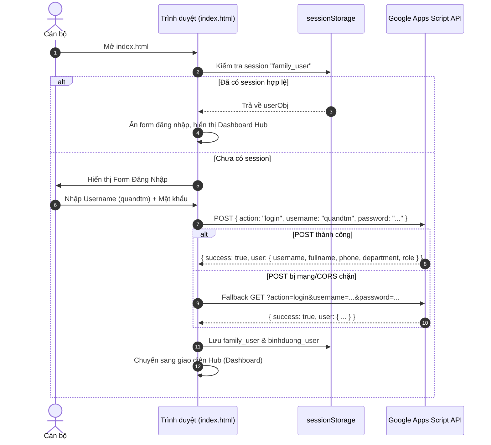
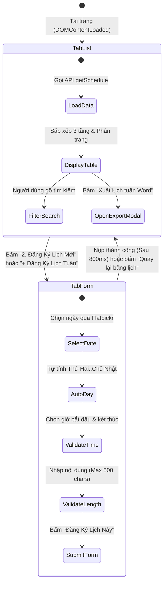
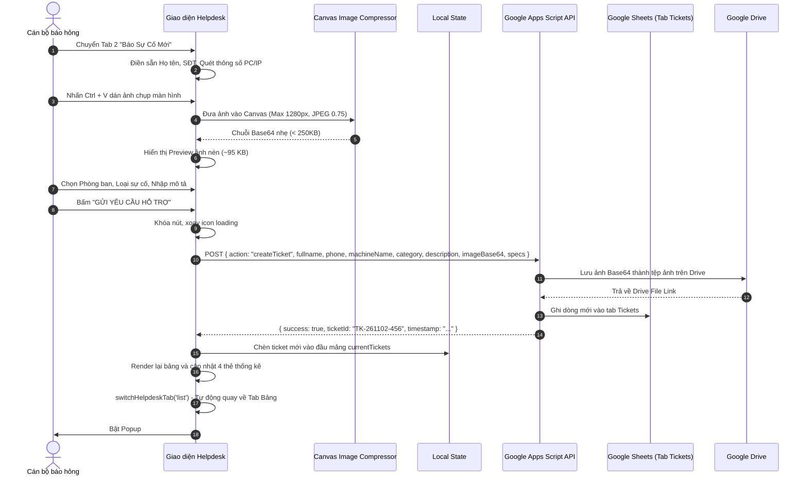

# TÀI LIỆU ĐẶC TẢ NGHIỆP VỤ & KỊCH BẢN KIỂM THỬ TỰ ĐỘNG
## HỆ THỐNG CỔNG DỊCH VỤ NỘI BỘ - VPĐK CHI NHÁNH SỐ 23 (FAMILY CN23)
> **Mã tài liệu**: `SPEC-CN23-WORKFLOWS-V3.9`  
> **Phân hệ trọng tâm**: 
> 1. Phân hệ 1: **Đăng Ký Lịch Công Tác Tuần** (`lich_tuan.html` & `js/app.js`)  
> 2. Phân hệ 2: **IT Helpdesk & Báo Sự Cố Máy Tính** (`it_helpdesk.html`)  
> 3. Cổng Đăng Nhập & Xác Thực Trung Tâm (`index.html` & `js/layout.js`)  
> **Mục đích tài liệu**: Cung cấp đặc tả luồng (User Stories, State Machine, Sequence Flow, Data Contracts, UI DOM Selectors, Test Scenarios) để làm đề bài chuẩn đưa vào các mô hình AI khác (Claude, GPT, DeepSeek) hoặc Framework kiểm thử (Playwright, Cypress, Vitest, Jest) thực hiện rà soát và sinh test script tự động.

---

> [!NOTE]
> **VAI TRÒ TÀI LIỆU (EXTERNAL TEST SPECIFICATION):**  
> Tài liệu này được lưu trữ để làm đề bài chuyển tiếp cho các mô hình AI khác hoặc framework tự động hóa kiểm thử bên ngoài khi cần kiểm tra chéo. Tài liệu này **KHÔNG ÁP ĐẶT** quy trình phát triển thác nước (không bắt buộc viết spec/analysis/design trước khi code). Toàn bộ quy chuẩn phát triển hàng ngày tuân thủ theo quy trình linh hoạt tại [`.agent/rules.md`](file:///Users/admin/Desktop/FAMILY_CN23/.agent/rules.md).

---

## MỤC LỤC
1. [Tổng Quan Kiến Trúc Kỹ Thuật (System & Tech Stack)](#1-tổng-quan-kiến-trúc-kỹ-thuật)
2. [Cổng Xác Thực & Quản Lý Phiên (Hub & Authentication Workflow)](#2-cổng-xác-thực--quản-lý-phiên)
3. [Đặc Tả Luồng 1: Đăng Ký Lịch Công Tác Tuần (Schedule Workflow)](#3-đặc-tả-luồng-1-đăng-ký-lịch-công-tác-tuần)
4. [Đặc Tả Luồng 2: IT Helpdesk & Tiếp Nhận Sự Cố (Helpdesk Workflow)](#4-đặc-tả-luồng-2-it-helpdesk--tiếp-nhận-sự-cố)
5. [Quy Chuẩn An Toàn & Bảo Vệ Dữ Liệu Cá Nhân (Security & PII Rules)](#5-quy-chuẩn-an-toàn--bảo-vệ-dữ-liệu-cá-nhân)
6. [Bộ Kịch Bản Kiểm Thử Nghiệm Thu (Acceptance Test Scenarios Matrix)](#6-bộ-kịch-bản-kiểm-thử-nghiệm-thu)
7. [Prompt Mẫu Đưa Sang Model Khác Để Kiểm Tra & Sinh Code Test](#7-prompt-mẫu-đưa-sang-model-khác)

---

## 1. TỔNG QUAN KIẾN TRÚC KỸ THUẬT

### 1.1. Công Nghệ Nền Tảng (Pure Vanilla Web)
- **Frontend Core**: HTML5, Modern CSS (CSS Variables, Flexbox/Grid), Vanilla JavaScript (ES6+).
- **Không sử dụng công cụ Build**: Tuyệt đối không dùng Node build steps, Vite, Webpack, Babel. Tất cả chạy trực tiếp trên trình duyệt.
- **Backend API**: Google Apps Script Web App (RESTful API Endpoint chạy chế độ serverless, kết nối cơ sở dữ liệu Google Sheets 5 tab: `TaiKhoan`, `LichTuan`, `Tickets`, `GiaoViec`, `BaoCaoSoLieu`).
- **Lưu trữ Tệp Tin (File Storage)**: Google Drive Folder lưu trữ ảnh chụp màn hình sự cố máy tính và tài liệu phần mềm.
- **Thư viện bên ngoài (CDN)**:
  - FontAwesome 6 (Icons)
  - Flatpickr (Bộ chọn ngày/tháng và giờ 24h)
  - docx UMD 8.5.0 + FileSaver.js (Tạo file Word `.docx` chuẩn Nghị định 30 trên client-side)

### 1.2. Chuẩn Thiết Kế Giao Diện (Design System)
- **Tỷ lệ màu 60-30-10** (theo `.agent/rules.md`):
  - `60% Nền chủ đạo`: `#f8fafc` (Slate 50), thẻ card trắng tinh `#ffffff`.
  - `30% Nhận diện cơ quan`: `#0f2b5c` / `#1e3a8a` (Royal Navy), Topbar cố định 60px viền vàng.
  - `10% Điểm nhấn hành động`: `#d97706` / `#f59e0b` (Gold Amber), nút CTA chính, huy hiệu trạng thái.
- **Container chuẩn**: Cố định độ rộng tối đa `1280px` (`max-w-7xl` / `.app-container`), căn giữa màn hình (`margin: 0 auto`), chống tràn ngang và thẳng hàng mép lề giữa các phân hệ.

---

## 2. CỔNG XÁC THỰC & QUẢN LÝ PHIÊN (HUB & AUTHENTICATION WORKFLOW)

### 2.1. User Story: Đăng Nhập Hệ Thống
- **Là**: Cán bộ Chi nhánh 23.
- **Tôi muốn**: Đăng nhập bằng Tên người dùng (Username, ví dụ: `quandtm`) và Mật khẩu cá nhân.
- **Để**: Truy cập các phân hệ nghiệp vụ nội bộ mà không bị rò rỉ số định danh cá nhân (CCCD).

### 2.2. State Machine & Sơ Đồ Tuần Tự (Authentication Flow)


### 2.3. Ràng Buộc Dữ Liệu Phiên (`family_user`)
Cấu trúc JSON lưu trong `sessionStorage.getItem("family_user")`:
```json
{
  "username": "quandtm",
  "fullname": "Đỗ Trọng Minh Quân",
  "name": "Đỗ Trọng Minh Quân",
  "phone": "0973807027",
  "email": "quandtm",
  "position": "Chuyên viên CNTT",
  "department": "Tổ Hành chính - Tổng hợp",
  "role": "admin",
  "status": "Đang làm việc"
}
```
> [!IMPORTANT]
> **Tuyệt đối KHÔNG chứa trường `cccd`**: Toàn bộ luồng đăng nhập không lưu trữ hoặc trả về số CCCD của cán bộ ra phía client.

---

## 3. ĐẶC TẢ LUỒNG 1: ĐĂNG KÝ LỊCH CÔNG TÁC TUẦN

### 3.1. User Stories & Personas

#### Story 1: Xem Lịch Công Tác Toàn Cơ Quan (Cán Bộ / Lãnh Đạo)
- **Là**: Cán bộ hoặc Lãnh đạo Chi nhánh số 23.
- **Tôi muốn**: Mở trang `lich_tuan.html` và thấy ngay Bảng lịch công tác tuần toàn màn hình với trạng thái cuộc họp thời gian thực.
- **Tiêu chuẩn nghiệm thu (Acceptance Criteria)**:
  - Bảng rộng 100%, không bị bóp nghẹt.
  - Phân loại rõ ràng: Đang diễn ra (chấm xanh nhấp nháy) &bull; Sắp tới &bull; Đã qua (gạch ngang mờ).
  - Cột nội dung và thành phần kẹp tối đa 2 dòng (`-webkit-line-clamp: 2`), có nút "Xem thêm" mở Popup toàn văn khi nội dung dài.

#### Story 2: Đăng Ký Lịch Cuộc Họp Mới
- **Là**: Cán bộ phụ trách tổ chức cuộc họp hoặc thư ký đơn vị.
- **Tôi muốn**: Nhấp vào nút "Đăng Ký Lịch Mới", điền thông tin họp với hệ thống hỗ trợ tính toán tự động và nộp lên hệ thống.
- **Tiêu chuẩn nghiệm thu**:
  - Chọn ngày dạng DD/MM/YYYY qua Flatpickr, tự động điền Thứ (Thứ Hai, Thứ Ba,...).
  - Chọn giờ bắt đầu và kết thúc hệ 24h, tự động chặn nếu `Giờ kết thúc <= Giờ bắt đầu`.
  - Giới hạn 500 ký tự kèm bộ đếm thời gian thực cho Nội dung, Thành phần, Địa điểm.
  - Sau khi nộp thành công: Tự động chuyển về Bảng lịch sau 800ms để quan sát mục vừa đăng ký.

#### Story 3: Xuất File Word (.docx) Chuẩn Nghị Định 30
- **Là**: Chuyên viên tổng hợp hoặc Lãnh đạo duyệt lịch.
- **Tôi muốn**: Xuất danh sách cuộc họp ra file Word `.docx` chuẩn thể thức văn bản hành chính nhà nước.
- **Tiêu chuẩn nghiệm thu**:
  - Tùy chọn phạm vi xuất: Toàn bộ, Tuần này, Tuần sau, Tháng này hoặc Khoảng ngày tùy chọn.
  - Định dạng chuẩn NĐ 30/2020: Căn lề Trái 30mm, Phải 15mm, Trên 20mm, Dưới 20mm. Font Times New Roman 13-14pt.
  - Tiêu đề cơ quan: `VĂN PHÒNG ĐĂNG KÝ ĐẤT ĐAI THÀNH PHỐ HỒ CHÍ MINH / CHI NHÁNH SỐ 23`.
  - Khung ký duyệt: `GIÁM ĐỐC / Nguyễn Chiến Thắng`.
  - Highlight màu đỏ tự động các từ khóa: `Chi nhánh 23`, `CN23`, `23`.

---

### 3.2. Bản Đồ Phần Tử DOM (Test Selectors Dictionary - `lich_tuan.html`)

| Element ID | Loại thẻ | Mục đích kiểm thử / Tác vụ |
| :--- | :--- | :--- |
| `pageTitleStrip` | `div` | Tiêu đề phân hệ Lịch công tác tuần |
| `tabBtnScheduleList` | `button` | Chuyển sang Tab 1: Xem Bảng Lịch Tuần |
| `tabBtnScheduleRegister`| `button` | Chuyển sang Tab 2: Mở Form Đăng Ký Mới |
| `btnQuickOpenRegister` | `button` | Nút CTA nhanh "+ Đăng Ký Lịch Tuần" |
| `listSection` | `section` | Container Tab 1 chứa bảng (Mặc định `display: block`) |
| `formSection` | `section` | Container Tab 2 chứa form (Mặc định `display: none`) |
| `btnRefreshList` | `button` | Làm mới dữ liệu từ Google Sheet |
| `btnExportWord` | `button` | Mở Modal cấu hình xuất file Word NĐ 30 |
| `searchInput` | `input` | Ô tìm kiếm lịch thời gian thực (nội dung, người gửi, địa điểm) |
| `scheduleTable` | `table` | Bảng hiển thị danh sách lịch |
| `scheduleTableBody` | `tbody` | Nơi render các dòng cuộc họp |
| `paginationControls` | `div` | Cụm nút phân trang (10 mục / trang) |
| `registerForm` | `form` | Form đăng ký lịch |
| `regDate` | `input` | Ô chọn ngày họp DD/MM/YYYY |
| `regDayOfWeek` | `input` | Ô Thứ trong tuần (Tự động điền, `readonly`) |
| `regStartTime` | `input` | Giờ bắt đầu (Hệ 24h, ví dụ: 08:00) |
| `regEndTime` | `input` | Giờ kết thúc (Hệ 24h, ví dụ: 10:00) |
| `regContent` | `textarea`| Nội dung cuộc họp (Maxlength 500) |
| `contentCounter` | `span` | Bộ đếm ký tự nội dung (x / 500 ký tự) |
| `regAttendees` | `textarea`| Thành phần tham dự (Maxlength 500) |
| `attendeesCounter` | `span` | Bộ đếm ký tự thành phần |
| `regLocation` | `input` | Địa điểm tổ chức cuộc họp |
| `locationCounter` | `span` | Bộ đếm ký tự địa điểm |
| `btnSubmitRegister` | `button` | Nút gửi nộp lịch họp |
| `btnResetForm` | `button` | Nút xóa trắng biểu mẫu |
| `modalExportWord` | `div` | Modal cấu hình xuất văn bản Word |
| `scopeAll` / `scopeRange`| `input` | Radio chọn xuất toàn bộ hoặc theo khoảng ngày |
| `exportFromDate` | `input` | Ngày bắt đầu xuất Word |
| `exportToDate` | `input` | Ngày kết thúc xuất Word |
| `btnConfirmExport` | `button` | Nút kích hoạt tải file `.docx` về máy |

---

### 3.3. Quy Trình Trạng Thái Tab (Schedule Tab State Flow)



---

## 4. ĐẶC TẢ LUỒNG 2: IT HELPDESK & TIẾP NHẬN SỰ CỐ MÁY TÍNH

### 4.1. User Stories & Personas

#### Story 1: Tiếp Nhận & Theo Dõi Tiến Độ Trực Tiếp (Live Queue / Monitoring)
- **Là**: Cán bộ trong cơ quan hoặc Kỹ thuật viên IT Chi nhánh 23.
- **Tôi muốn**: Vừa vào trang `it_helpdesk.html` là quan sát được ngay toàn bộ hàng đợi sự cố trên màn hình rộng 100%.
- **Tiêu chuẩn nghiệm thu**:
  - 4 thẻ số liệu thống kê: Tổng Ticket &bull; Chờ xử lý &bull; Đang xử lý &bull; Đã hoàn thành.
  - Bộ lọc tìm kiếm nhanh theo tên cán bộ, SĐT, phòng ban, câu thông báo lỗi.
  - Thứ tự ưu tiên hàng đầu: Ticket **Đang xử lý** hiển thị trên cùng &rarr; **Chờ xử lý** &rarr; **Đã hoàn thành** xếp dưới cùng. Trong từng nhóm, sắp xếp từ mới nhất đến cũ nhất.

#### Story 2: Báo Lỗi Máy Tính Siêu Tốc Kèm Dán Ảnh (<kbd>Ctrl + V</kbd>)
- **Là**: Cán bộ gặp sự cố máy tính, máy in, mạng, chữ ký số.
- **Tôi muốn**: Chuyển sang Tab 2 "Báo Sự Cố Mới", hệ thống đã tự điền sẵn Họ tên, SĐT, Cấu hình máy/IP, cho phép chụp màn hình dán trực tiếp <kbd>Ctrl + V</kbd> và gửi ticket.
- **Tiêu chuẩn nghiệm thu**:
  - Không cần gõ lại Họ tên, SĐT.
  - Tự động nhận diện cấu hình máy ngầm (`IP`, `OS`, `Specs RAM/Cores`, `MachineTag PC-xxxx`).
  - Dán ảnh chụp màn hình bằng phím tắt <kbd>Ctrl + V</kbd> hoặc kéo thả: Tự động dùng HTML5 Canvas nén ảnh dạng JPEG 0.75 xuống dưới `250KB` (Resize tối đa 1280px).
  - Nộp ticket thành công: Hiện Popup chúc mừng mã `#TK-xxxx` và **tự động chuyển ngay về Tab 1 xem bảng** để thấy ticket của mình xuất hiện trên đầu.

#### Story 3: Xem Toàn Văn Chi Tiết & Ảnh Gốc Trên Google Drive
- **Là**: Kỹ thuật viên IT hoặc Cán bộ gửi yêu cầu.
- **Tôi muốn**: Nhấp vào bất kỳ dòng ticket nào để xem Popup chi tiết sự cố và phóng to ảnh chụp màn hình.
- **Tiêu chuẩn nghiệm thu**:
  - Modal `#modalTicketDetail`: Hiển thị người gửi, phòng ban, SĐT (không có CCCD), thiết bị, thông số, lỗi tiếng Anh, mô tả, ảnh thumbnail, ghi chú xử lý từ IT.
  - Modal `#modalImageViewer`: Xem ảnh phóng to, hỗ trợ ảnh Base64 local hoặc ảnh lưu trên Google Drive (kèm nút "Mở trên Google Drive" nếu trình duyệt chặn cookie nhúng).

---

### 4.2. Bản Đồ Phần Tử DOM (Test Selectors Dictionary - `it_helpdesk.html`)

| Element ID | Loại thẻ | Mục đích kiểm thử / Tác vụ |
| :--- | :--- | :--- |
| `pageTitleStrip` | `div` | Tiêu đề trang IT Helpdesk |
| `tabBtnHelpdeskList` | `button` | Tab 1: Bảng Theo Dõi Sự Cố (Mặc định `active`) |
| `tabBtnHelpdeskRegister`| `button` | Tab 2: Báo Sự Cố Mới (Tạo Ticket) |
| `listSection` | `section` | Container Tab 1 Bảng theo dõi (100% width, mặc định hiển thị) |
| `formSection` | `section` | Container Tab 2 Form báo sự cố (880px, mặc định `display: none`) |
| `statTotal` | `div` | Số liệu thống kê: Tổng số ticket |
| `statPending` | `div` | Số liệu thống kê: Chờ xử lý |
| `statProcessing` | `div` | Số liệu thống kê: Đang xử lý |
| `statCompleted` | `div` | Số liệu thống kê: Đã hoàn thành |
| `filterSearch` | `input` | Ô tìm kiếm ticket thời gian thực |
| `filterStatus` | `select` | Bộ lọc trạng thái (`ALL`, `Chờ xử lý`, `Đang xử lý`, `Đã hoàn thành`) |
| `btnRefresh` | `button` | Nút làm mới dữ liệu từ server (`fetchTickets(true)`) |
| `refreshIcon` | `i` | Biểu tượng xoay tròn khi đang tải |
| `ticketTableBody` | `tbody` | Vùng render danh sách ticket cho Desktop/Tablet |
| `ticketCardsMobile` | `div` | Vùng render danh sách thẻ dọc cho Mobile |
| `emptyTableState` | `div` | Khung hiển thị khi không có ticket nào phù hợp |
| `requesterDisplayName` | `div` | Tên Cán bộ gửi yêu cầu (Đã xác thực) |
| `requesterPhoneBadge` | `span` | Huy hiệu Số điện thoại cán bộ |
| `requesterDisplayPhone` | `span` | Số điện thoại hiển thị (Tuyệt đối không hiển thị CCCD) |
| `fullname` | `input[hidden]` | Lưu họ tên cán bộ khi submit form |
| `phone` | `input[hidden]` | Lưu SĐT cán bộ khi submit form |
| `machineName` | `input[hidden]` | Lưu tên máy tự động nhận diện |
| `department` | `select` | Chọn phòng ban / tổ công tác |
| `category` | `input[radio]` | 6 phân loại lỗi (PC, Máy in, Mạng, Phần mềm, Chữ ký số, Khác) |
| `errorMessage` | `input` | Câu thông báo lỗi tiếng Anh hiện trên màn hình |
| `description` | `textarea`| Mô tả hiện tượng sự cố (Bắt buộc) |
| `dropZone` | `div` | Vùng nhận dán ảnh (Ctrl+V) hoặc kéo thả file ảnh |
| `fileInput` | `input[file]` | Input chọn file ảnh từ máy tính (`accept="image/*"`) |
| `dropZonePrompt` | `div` | Lời nhắc bấm chọn ảnh hoặc bấm Ctrl+V |
| `imagePreviewContainer`| `div` | Hộp chứa ảnh thu nhỏ sau khi nén |
| `imagePreview` | `img` | Thẻ ảnh xem trước |
| `imageSizeInfo` | `div` | Hiển thị dung lượng ảnh đã nén (~... KB) |
| `detectedSpecText` | `span` | Hiển thị thông số máy & IP Public quét tự động |
| `btnSubmitTicket` | `button` | Nút gửi ticket hỗ trợ |
| `modalSuccess` | `div` | Popup báo gửi thành công |
| `resTicketId` | `span` | Mã ticket trên Popup thành công (ví dụ: `#TK-261102-123`) |
| `resMachine` | `span` | Tên máy trên Popup thành công |
| `modalTicketDetail` | `div` | Modal xem toàn bộ thông tin chi tiết một ticket |
| `modalImageViewer` | `div` | Modal phóng to ảnh chụp màn hình sự cố |

---

### 4.3. Sơ Đồ Tuần Tự Gửi Ticket & Dán Ảnh (IT Helpdesk Sequence)



---

## 5. QUY CHUẨN AN TOÀN & BẢO VỆ DỮ LIỆU CÁ NHÂN (PII RULES)

Để bảo đảm tuyệt đối tuân thủ quy định bảo vệ dữ liệu cá nhân (Nghị định 13/2023/NĐ-CP):

| STT | Nguyên Tắc Kiểm Thử An Toàn | Tiêu Chuẩn Đánh Giá (Pass / Fail) |
| :---: | :--- | :--- |
| **SEC-01** | **Không hiển thị số CCCD trên UI** | Quét toàn bộ DOM Text: `0 visible CCCD text`. Form Helpdesk chỉ hiển thị Họ tên và SĐT. |
| **SEC-02** | **Không lưu CCCD vào Session** | `sessionStorage.getItem("family_user")` không chứa key `cccd`. |
| **SEC-03** | **Không trả CCCD qua API công khai** | Endpoint `?action=getUsers` và `?action=login` của Apps Script không trả trường `cccd` về client. |
| **SEC-04** | **Không rò rỉ CCCD vào trường SĐT** | Biến `phone` khi gửi ticket chỉ nhận số điện thoại thực tế, tuyệt đối không fallback sang số CCCD. |
| **SEC-05** | **Bảo vệ Route Guard** | Khi chưa có phiên đăng nhập, mở trực tiếp `lich_tuan.html` hoặc `it_helpdesk.html` phải chuyển hướng ngay về `index.html`. |

---

## 6. BỘ KỊCH BẢN KIỂM THỬ NGHIỆM THU (TEST SCENARIOS MATRIX)

### 6.1. Nhóm Test IT Helpdesk (`it_helpdesk.html`)

```markdown
### TEST CASE IT-01: Kiểm tra Route Guard
- Tiền điều kiện: Xóa sessionStorage ("family_user", "binhduong_user").
- Hành động: Mở URL `it_helpdesk.html`.
- Kết quả mong đợi: Trình duyệt tự động chuyển hướng về `index.html`.

### TEST CASE IT-02: Kiểm tra Tab mặc định khi mở trang
- Tiền điều kiện: Đã đăng nhập tài khoản hợp lệ.
- Hành động: Mở `it_helpdesk.html`.
- Kết quả mong đợi:
  + `#listSection` hiển thị (`display != 'none'`).
  + `#formSection` bị ẩn (`display: none`).
  + Nút `#tabBtnHelpdeskList` có class `active`.
  + Nút `#tabBtnHelpdeskRegister` không có class `active`.

### TEST CASE IT-03: Kiểm tra chuyển đổi Tab mượt mà
- Hành động: Bấm nút tab `tabBtnHelpdeskRegister`.
- Kết quả mong đợi:
  + `#listSection` bị ẩn (`display: none`).
  + `#formSection` hiển thị (`display: block`).
  + `#tabBtnHelpdeskRegister` có class `active`.
  + Trang cuộn mượt lên vị trí đầu form.
  + Bấm nút "Quay lại bảng sự cố": Quay lại đúng Tab `#listSection`.

### TEST CASE IT-04: Dán ảnh màn hình bằng phím tắt Ctrl + V & Nén Canvas
- Tiền điều kiện: Đang ở Tab Form `#formSection`. Ảnh mẫu dung lượng gốc 2MB (PNG).
- Hành động: Bấm <kbd>Ctrl + V</kbd> trên bàn phím.
- Kết quả mong đợi:
  + Sự kiện paste kích hoạt hàm `compressAndPreviewImage`.
  + Thẻ `#imagePreviewContainer` bỏ class `hidden`.
  + Ô `#imagePreview` hiển thị đúng ảnh dạng DataURL (`data:image/jpeg;base64,...`).
  + Dung lượng hiển thị tại `#imageSizeInfo` đạt mức < 250 KB.
  + Bấm nút x màu đỏ (`removeSelectedImage`): Xóa ảnh, hoàn nguyên ô dán ban đầu.

### TEST CASE IT-05: Gửi Ticket & Tự động quay về Tab Bảng Live Queue
- Tiền điều kiện: Đã điền đầy đủ Phòng ban, Phân loại, Mô tả.
- Hành động: Nhấn nút `#btnSubmitTicket`.
- Kết quả mong đợi:
  + Gửi yêu cầu qua API thành công (hoặc sinh mã vé offline hợp lệ dạng `TK-YYMMDD-XXX`).
  + Mảng `currentTickets` tăng thêm 1 mục ở vị trí đầu tiên.
  + Giao diện tự động kích hoạt `switchHelpdeskTab('list')`: Tab Form biến mất, Tab Bảng hiển thị.
  + Modal `#modalSuccess` hiện ra với đúng mã Ticket và tên máy.
  + Số liệu `#statTotal` và `#statPending` tăng thêm 1 đơn vị.

### TEST CASE IT-06: Sắp xếp thông minh & Bộ lọc trạng thái
- Tiền điều kiện: Danh sách có 3 ticket: 1 "Đã hoàn thành", 1 "Chờ xử lý", 1 "Đang xử lý".
- Hành động: Quan sát thứ tự trong `#ticketTableBody`.
- Kết quả mong đợi:
  + Dòng 1: Ticket có trạng thái "Đang xử lý".
  + Dòng 2: Ticket có trạng thái "Chờ xử lý".
  + Dòng 3: Ticket có trạng thái "Đã hoàn thành".
  + Chọn bộ lọc `#filterStatus` = "Đang xử lý": Chỉ hiển thị đúng 1 ticket đang xử lý.
```

---

### 6.2. Nhóm Test Đăng Ký Lịch Tuần (`lich_tuan.html`)

```markdown
### TEST CASE SCH-01: Ràng buộc Giờ kết thúc > Giờ bắt đầu
- Hành động: Chọn Ngày = Ngày mai; Giờ bắt đầu = "10:00"; Giờ kết thúc = "09:00".
- Kết quả mong đợi: Hệ thống phát thông báo cảnh báo "Giờ kết thúc phải diễn ra sau giờ bắt đầu" và chặn việc gửi form.

### TEST CASE SCH-02: Giới hạn ký tự và bộ đếm tự động
- Hành động: Nhập chuỗi 501 ký tự vào `#regContent`.
- Kết quả mong đợi:
  + Ô textarea chặn không cho gõ ký tự thứ 501 (`maxlength="500"`).
  + Thẻ `#contentCounter` hiển thị đúng "500 / 500 ký tự".

### TEST CASE SCH-03: Sắp xếp cuộc họp 3 tầng thời gian
- Dữ liệu thử nghiệm:
  + Mục A: Cuộc họp ngày hôm qua.
  + Mục B: Cuộc họp đang trong khung giờ hiện tại hôm nay.
  + Mục C: Cuộc họp chiều nay.
  + Mục D: Cuộc họp tuần sau.
- Kết quả mong đợi: Thứ tự hiển thị lần lượt: Mục B (Đang diễn ra) &rarr; Mục C (Chiều nay) &rarr; Mục D (Tuần sau) &rarr; Mục A (Đã diễn ra).

### TEST CASE SCH-04: Xuất văn bản Word chuẩn NĐ 30 theo khoảng ngày
- Hành động:
  + Bấm nút `#btnExportWord`.
  + Chọn radio `#scopeRange`.
  + Chọn từ ngày thứ 2 đến thứ 6 của tuần hiện tại.
  + Bấm `#btnConfirmExport`.
- Kết quả mong đợi:
  + Trình duyệt tự động tải xuống file `.docx` có tên: `Lich_Cong_Tac_Tuan_Tu_..._Den_....docx`.
  + Mở file kiểm tra: Có đủ Quốc hiệu, Tiêu ngữ, Bảng 6 cột chuẩn, các từ khóa "Chi nhánh 23" được tô màu đỏ in đậm, dòng ký duyệt Giám đốc Nguyễn Chiến Thắng.
```

---

## 7. PROMPT MẪU ĐƯA SANG MODEL KHÁC

Bạn có thể copy toàn bộ đoạn prompt bên dưới để dán vào mô hình AI khác (như ChatGPT-4o, Claude 3.5 Sonnet, DeepSeek) để yêu cầu mô hình đó kiểm thử hoặc sinh code test tự động:

```markdown
Bạn là Chuyên gia Kiểm thử Tự động (Senior QA / Test Automation Engineer). 
Dưới đây là Tài liệu Đặc tả Nghiệp vụ & Kịch bản Kiểm thử của Hệ thống Cổng Dịch Vụ Nội Bộ VPĐK Chi Nhánh Số 23 (dự án Pure Vanilla Web HTML5/CSS/JS kết nối Google Apps Script API):

[DÁN TOÀN BỘ NỘI DUNG TỪ PHẦN 1 ĐẾN PHẦN 6 CỦA FILE NÀY VÀO ĐÂY]

Dựa vào tài liệu đặc tả trên, hãy thực hiện các nhiệm vụ sau:
1. Đánh giá tính logic và độ bao phủ của 2 luồng: IT Helpdesk và Đăng ký Lịch công tác tuần. Có bước nào tiềm ẩn nguy cơ race condition, nghẽn mạng hoặc lỗi người dùng không?
2. Viết bộ kiểm thử End-to-End tự động hoàn chỉnh bằng Playwright (hoặc Cypress / Puppeteer) kiểm tra 100% các Test Case từ TC-IT-01 đến TC-IT-06 và TC-SCH-01 đến TC-SCH-04, sử dụng đúng các Element ID đã được đặc tả trong bảng Selectors Dictionary.
3. Xác nhận rằng trong toàn bộ luồng kiểm thử không có bất kỳ điểm nào vi phạm quy tắc an toàn thông tin cá nhân (SEC-01 đến SEC-05, tuyệt đối không để lộ CCCD).
```

---
*Tài liệu được khởi tạo và chuẩn hóa tự động vào lúc 10:30 ngày 02/11/2026 bởi Antigravity Pair-Programming Agent.*
